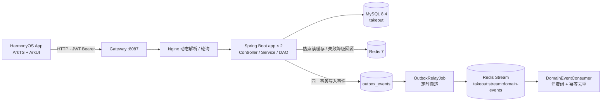

# 简单外卖 · simple-takeout

> HarmonyOS NEXT 外卖点餐 App（毕业设计 / 学习项目，业务对标美团外卖）。
>
> 前端为单 HAP 工程（ArkTS + ArkUI，API 26），后端为 Spring Boot 服务端（Java 25），
> 数据存储于 MySQL，热点数据缓存与领域事件使用 Redis，并提供 Docker Compose 一键环境。
>
> 覆盖**四端**：用户（点外卖）— 商户（接单出餐）— 骑手（抢单配送）— 平台管理。

## 在线访问

| 入口 | 链接 |
| --- | --- |
| 个人博客 | [hqyx.website](https://hqyx.website/) |
| 项目介绍 | [查看作品](https://hqyx.website/projects) |
| 简单外卖网页端 | [在线体验](https://hqyx.website/takeout/) |

博客支持 HTTPS，输入域名会自动跳转到安全连接。外卖网页端通过同一域名的 `/takeout/` 路径访问，与 HarmonyOS 客户端共用服务端数据。

**2026-10-25 安全复测基线**：截至当日 23:01，十轮攻防结束，基线版本为 `defense-20261025-225329`，包含第三至第十轮累计修复。该轮后端完整 reactor 实测 594 项全部通过；线上 28 项检查通过，30 路正确登录均返回 200，540 家店目录缓存为 451986 字节，第二次请求未回源。当时 demo 为单 app 副本，登录验密 2 许可 / 等待 10000 ms；源码默认等待为 5000 ms。该轮未执行线上下单、支付或退款，也未安装新的手机 HAP。这些结果属于当时的安全基线；完整证据与保留的 RT-16/22/31/32 风险见 [最终结论](md/audit/最终结论.md) 和 [第十轮回复](md/audit/round10/第十轮防御-回复.md)。

## 六批业务与交互改造现状（2026-10-26）

当前源码已完成六批改造，问题依据、逐批实施与验证证据见 [人性化改造诊断与实施方案](md/人性化改造诊断与实施方案.md)。本次服务器同步与 GitHub 发布尚在核验，下面描述源码及本地验证结果。

| 范围 | App / Web 已实现能力 |
| --- | --- |
| 搜索、地址与购物车 | 搜索失败和零结果分开并可重试；地址区分地图位置和详细门牌；结算按所选店铺处理；App 单项删除支持短时撤销，多店部分成功只重试失败店铺 |
| 结算与优惠 | 按单店商品门槛、真实有效期和券后正实付判断券资格，解释不可用原因并保留主动“不使用”；地址往返和失败保留输入；结果未知时沿用原请求核对，避免重复建单 |
| 履约与取消 | 暂停新建自取和预约单；用户只可取消待付款 / 待商家接单订单；制作、配送阶段转平台处理；商家待接单可结构化拒单，缺货校验到 SKU，按原渠道退款并恢复仍有效的券 |
| 退款闭环 | 本人订单可查看退款编号、原因、金额、处理时间和驳回理由；同一次申请重试不重复创建；管理端同意前确认、拒绝必填用户可见理由，提交锁与结果对账覆盖慢网 |
| 骑手与平台 | 抢单前脱敏，履约时可查看和复制完整地址、打开系统拨号及按需查看门店地点；送达前确认，终态隐藏收货隐私；运营订单、退款接分页、筛选与过时响应守卫 |

验证已覆盖本地 API、浏览器和模拟器的受影响链路；发版前 Web 四套 Node 回归 76 / 76 通过，静态 JavaScript 语法检查通过，正式域名优先的 debug HAP 构建为 `BUILD SUCCESSFUL`。后端各批全量与真实 MySQL 回归数量、条件跳过范围见实施记录，不把条件跳过计为已执行。

仍有明确边界：优惠展示为预估，营销叠加和最终金额由服务端决定；未知建单结果的冻结请求保留在当前页面 / 浏览器会话，进程清理后需从真实订单核对；确认 / 评价后的售后政策、部分退款与图片证据工单、骑手持久异常上报、收货地点精确坐标导航、餐具和配送偏好分发尚未完成。正式外部支付与退款、物理真机、全页面 200% 字号 / 深色回归及 Release 签名仍需专项验收；现有 debug HAP 为未签名产物。

## 功能特性

### 用户端（CUSTOMER）

- 首页分类导航、推荐/附近店铺列表、店铺与商品搜索、轮播 Banner 与公告
- 店铺详情、商品列表（分类分组、限时特惠、**多规格 SKU**）、收藏店铺
- **限时秒杀专区**、店铺/商品榜单、凑单推荐（还差多少元起送）
- 优惠券领取、资格说明与下单核销（按单店商品总价判断门槛；预估推荐保留“不使用”选择）
- 购物车（服务端持久化，按账号隔离，按 `(goods_id, spec_id)` 区分规格）
- **结算下单（待付款模型）**：下单只占用库存/秒杀名额/优惠券并生成待付款订单，
  15 分钟内完成支付，超时自动取消并回滚占用
- 余额支付、支付宝沙箱支付、订单跟踪、确认收货、图文评价（评价图片上传）、退款申请与历史进度
- 收货地址管理（含高德地图定位/选点、详细门牌、标签与默认地址）
- 钱包余额与银行卡管理、个人资料编辑、订单售后帮助、隐私政策、设置等；未接入的热线 / 在线客服不冒充可用渠道，演示充值与注册赠金已停用

### 商户端（MERCHANT）

- 店铺资料维护、平台分类下开店
- 商品管理（增删改、上下架、库存、**多规格 SKU**、商户自定义分类、限时特惠标记）
- 订单处理：接单 → 出餐（订单进入骑手待取餐池）；配送与送达由骑手端推进
- 待接单支持结构化无法接单、订单内缺货商品 / 规格停售、原渠道退款及用户可见原因
- 评价回复
- 营业额统计（仅统计已结算订单，区分待结算/已结算）

### 骑手端（RIDER）

- 上线 / 下线（仅在线可抢单）
- 待取餐订单池、抢单
- 取餐 → 确认实际交付 → 送达，推进配送流程；慢网下核对服务端结果
- 履约时完整地址复制、系统拨号和门店位置入口；抢单前及终态按权限隐藏收货隐私
- 个人资料，累计单量与收入

### 平台管理端（ADMIN）

- 独立后台：登录后直接进入管理页，不展示用户端首页/定位/购物车
- 平台分类管理、店铺审核（上下架/推荐）、全平台商品与用户管理
- 平台管理员（员工）账号管理
- **骑手管理**
- **内容管理**：轮播 Banner、公告
- 全平台订单查看与管理、经营统计（总览 + 订单趋势）
- 已送达订单的退款审批（待审 / 全部、分页；同意前确认金额，拒绝必填用户可见理由）

### 技术亮点

- **Redis 热点缓存**：缓存分类/店铺/商品/秒杀/榜单/Banner/公告等读多写少的浏览类数据。
  三类故障均有针对性防护——防**穿透**（不存在的对象写空值占位，短 TTL）、
  防**击穿**（回源前 `SET NX` 互斥锁，抢不到锁则降级回源而非阻塞）、
  防**雪崩**（TTL 叠加随机抖动）。**缓存 Redis 故障时回源数据库；登录限流遇到慢调用或故障时改用有界本地窗口**。初次慢调用及恢复探测仍有延迟，降级时跨副本限流预算暂不共享。
- **领域事件异步化**：采用**事务性 Outbox** —— 事件与业务写入在**同一事务**落 `outbox_events` 表
  （要么一起提交、要么一起回滚，不会出现「幽灵事件」或「丢事件」），提交后由定时中继搬运到
  Redis Stream，消费组 + 去重键保证幂等。下单/支付/取消/退款事件异步驱动下游动作，
  **下单主流程保持同步事务**（防超卖依赖数据库条件更新的原子性）。
- **资金平台托管**：用户支付后资金 `escrow_status=0` 托管，确认收货后才结算给商户。
- **幂等与并发安全**：下单使用数据库唯一键兜底、Redis 快速拦截；退款/结算使用带状态条件的更新防止竞态和重复入账；
  库存/秒杀名额用乐观锁（`WHERE stock >= ?`、`sold + ? <= quota`）防超卖。
  **刻意不依赖 Redis 锁**：Redis 锁覆盖不到数据库写入，宕机时反而更弱。
- **容器化**：`docker compose up -d --build` 一条命令拉起后端 + MySQL + Redis（含健康检查与启动顺序）。

## 技术栈

| 端 | 技术 | 说明 |
| --- | --- | --- |
| 前端 | HarmonyOS NEXT · ArkTS（严格模式）+ ArkUI | `targetSdkVersion` / `compatibleSdkVersion` **26.0.0**，单 HAP；仅依赖 `@ohos/axios`，无第三方 UI 库 |
| 前端存储 | AppStorage + Preferences | 登录态、购物车展示等本地持久化 |
| 后端 | Spring Boot 3.5.16 · Java 25 | 分层 Controller / Service / DAO；JWT 认证（jjwt 0.12.6）+ 自定义拦截器（**未引入 Spring Security**） |
| 后端数据访问 | JdbcTemplate + 既有 MyBatis-Plus 映射 | 主要 DAO 位于 `server/takeout-common`；购物车等路径使用 `server/takeout-app` 的实体 / Mapper，与业务事务配合 |
| 数据库 | MySQL 8.4 | 库名 `takeout`；启动自动执行 `schema.sql`，`SchemaMigration` 兼容旧库，`DataSeeder` 填充种子数据 |
| 缓存 | Redis 7（Lettuce 连接池） | 热点浏览数据缓存；故障快速降级（500ms 超时 + 短连接超时） |
| 消息 | Redis Stream + 事务性 Outbox | 领域事件异步投递，**未引入 RabbitMQ/RocketMQ 等外部 MQ** |
| 容器化 | Docker · Docker Compose | 后端镜像基于 JDK 25 多阶段构建；MySQL 8.4 + Redis 7 |
| 地图 | 高德 Web 端 JS API v2.0 | 通过 ArkUI `Web` 组件内嵌运行，模拟器/真机均可用，无 native 依赖 |
| 测试 | JUnit 5、Hypium、Node.js 原生测试 | `server/*/src/test`、`entry/src/test`、`entry/src/ohosTest`、`scripts/*.test.cjs`；2026-10-25 的 594 项为安全基线，六批 UX 与后续发布验证以 [实施记录](md/人性化改造诊断与实施方案.md) 为准；设备 HAP 编译通过不等于 UiTest 已运行 |

## 系统架构



> 事件流的关键点：**事件先随业务事务落库**，再由中继异步搬运到 Stream。
> 中继**永不放弃投递**（事件已在库中，重试近乎零成本），因此 Redis 短暂故障不会导致事件丢失。

## 仓库结构

```
simple-takeout/
├── AppScope/                 # 应用级配置（bundleName: com.example.jiandanwaimai，应用名：简单外卖）
├── entry/                    # HarmonyOS App 模块（ArkTS 源码、页面、测试）
│   └── src/
│       ├── main/ets/
│       │   ├── entryability/ # EntryAbility
│       │   ├── pages/        # 用户端 / 商户端 / 骑手端 / 管理端页面
│       │   ├── components/   # 通用组件（确认弹窗、评分、状态时间轴等）
│       │   ├── service/      # HttpClient/ApiService、本地持久化、订单计算、定位等
│       │   ├── common/       # 常量（颜色、API 配置、订单状态文案等）
│       │   └── model/        # 数据模型
│       ├── test/             # Hypium 本地单元测试
│       └── ohosTest/         # UiTest 设备端自动化测试
├── server/                   # Spring Boot 多模块后端（应用端口 8087）
│   ├── takeout-common/        # 共享 model、DAO、安全与通用组件
│   ├── takeout-app/           # Controller、Service、Job、配置、schema.sql 与应用测试
│   │   └── docker/healthcheck.java # 容器探活（运行镜像无 curl/wget）
│   ├── takeout-gateway/       # API 网关
│   └── pom.xml                # Maven 聚合根
│   └── Dockerfile            # 多阶段构建（JDK 25）
├── docker-compose.yml        # 一键环境：app + MySQL 8.4 + Redis 7
├── logs/                     # 运行日志（按服务分目录，内容不入库）
├── signing/                  # Release 签名配置模板（勿提交真实证书/密码）
├── scripts/                  # 设备实测 / 上架体检等 PowerShell 脚本
├── md/                       # 开发指南、归档资料（archive/）与安全复测资料（audit/）
├── .agents/                  # AI 编码助手技能与功能规格
├── AGENTS.md                 # 项目开发记忆（业务口径与陷阱清单，改代码前必读）
├── build-profile.json5 / oh-package.json5 / hvigorfile.ts / code-linter.json5   # 工程构建配置
└── (hvigor/ 构建工具配置；实际构建在 DevEco Studio 中完成)
```

## 快速开始

### 方式一：Docker Compose 单机双实例

Compose 必须显式设置 `SPRING_PROFILES_ACTIVE=develop` 或 `production`。develop 支持本地上传和支付宝沙箱支付；种子数据默认关闭。所有 profile 均要求 QQ 邮箱验证和限流，禁止演示充值、注册赠金、验证码回传及 mock 支付。启用支付宝时必须配置应用密钥、公钥、HTTPS 回调地址及与沙箱开关一致的网关；production 另要求 OBS，不能用本地上传。体验站按项目约定使用沙箱支付宝与余额支付，不代表正式支付渠道已验收。首次初始化本地种子数据时必须提供至少 16 位独立管理员口令，普通种子账号使用随机口令。

首次启动前，将 `.env.example` 复制为仓库根目录 `.env`，并替换数据库密码和 JWT 密钥。Compose 与后端容器使用 `.env` 中的数据库用户名和密码；不要把真实密钥提交到 Git。项目的 Compose 配置均集中在 `.env`，其中生产短信、OBS、推送和支付凭证仅在启用相应生产服务时填写：

```powershell
Copy-Item .env.example .env
```

`.env.example` 是变量清单和无密钥示例，不包含真实密码或密钥。已有 MySQL 数据卷不会因修改 `.env` 而自动改密码；应用账号对应 `TAKEOUT_DB_USERNAME` / `TAKEOUT_DB_PASSWORD`，独立 root 账号对应 `TAKEOUT_MYSQL_ROOT_PASSWORD`，变更时分别修改数据库中对应账号，不要将两者设为同一口令。JWT 密钥变更后需重新登录；钱包等加密密钥变更涉及存量密文迁移，不能随重建任意替换。直接运行 Maven 时，Spring Boot 不会自动读取根目录 `.env`，需先将 `.env` 导入启动进程环境。

```bash
docker compose up -d --build --wait
docker compose ps
docker compose logs -f app
docker compose down  # 停止并保留数据卷
```

- 默认 7 个容器：gateway、app-balancer（Nginx）、app × 2、mysql、redis、backup。
- 请求链路：`localhost:8087 → gateway → app-balancer:8087 → app:8087`；app 不映射宿主机 9100。
- MySQL / Redis 宿主端口为 3310 / 6387；当前是本地开发配置，不应直接暴露公网。
- 两个 app 共用数据库、Redis 和 `uploads-data` 卷，图片暂不迁移对象存储；仅支持同一 Docker 主机共享本地卷。
- `docker compose up -d --scale app=3` 可临时扩到三个副本；要永久修改默认数量，请修改 Compose 的 `app.deploy.replicas`。Nginx 每 5 秒重新解析 app 地址，不自动重试业务请求。
- 备份每个自然月首次运行时生成一次 `takeout-YYYYMM.sql.gz`，保存在 `mysql-backups` 卷；每小时检查并重试失败备份，重启不重复当月已成功的备份，当前不自动删除历史文件。
- `docker compose logs backup` 查看备份结果；导出副本：`docker compose cp backup:/backups ./TemporaryCacheStorage/mysql-backups`。备份卷与数据库同机，仍需另外保留异机副本。
- 运行日志统一保存在项目根目录 `logs/`：`logs/app/app.log`（应用）、`logs/gateway/gateway.log`（网关）、`logs/app-balancer/`（内部 Nginx）、`logs/public-nginx/`（公网 Nginx）。应用和网关按天/单文件 2MB 轮转并保留 30 天；Nginx 每天检查、超过 10MB 提前轮转并保留 14 份。HarmonyOS 客户端日志位于应用沙箱 `filesDir/logs/mobile/`。实时查看可用 `Get-Content logs/app/app.log -Wait` 或 `tail -f logs/app/app.log`。
- Docker 控制台日志仍可用 `docker compose logs -f app` 查看；`logs/` 下的文件日志用于持久化排查，容器重建不会丢失。
- **不要执行 `docker compose down -v`**，它会删除数据库、Redis、上传图片及备份卷。

#### 公网网页体验

网关同时托管一个无需单独构建的浏览器体验页，访问 [简单外卖在线体验](https://hqyx.website/takeout/)。个人博客与项目介绍分别位于 [博客首页](https://hqyx.website/) 和 [作品页](https://hqyx.website/projects)。

网页通过手机号、密码及所选角色登录，公开注册只开通普通用户，商户、骑手和管理员由平台开通。网页端与 HarmonyOS 客户端共用服务端账号、购物车、地址和订单数据。网页端按登录角色提供用户、商户、骑手和平台管理工作区：用户可浏览/搜索/收藏店铺、领券、维护地址和钱包、加入购物车、创建待付款订单、支付、取消、退款、确认收货和评价；商户可处理订单、维护门店商品、库存规格、评价回复和营销活动；骑手可上线、设置接单范围、抢单、取餐和送达；平台可查看总览、审核店铺、处理订单退款、管理用户商品、骑手、内容、员工、日志和营销。

网页支持通过“更换位置”搜索并手动选择其他地点；设备定位通过 HTTPS 安全连接请求浏览器授权，也可手动搜索其他位置。站内接口和上传图片使用相对路径，统一经 `/takeout/` 入口访问。

云端由 [域名 Nginx 配置](server/docker/nginx-domain.conf) 统一代理：博客与外卖上游分别仅绑定本机 `9080`、`9087` 端口，演示 Compose 使用 `TAKEOUT_APP_PORT=9087`。旧 IP 入口及 `8080` / `8087` 端口跳转到域名下的 HTTPS 页面。手机端的域名基址统一配置在 `API_CONFIG.REMOTE_BASE_URL`。

2026-10-25 安全复测边界：当时线上 demo 是单 app 副本，应用、网关、MySQL、Redis 均健康，与主 Compose 默认双副本拓扑不同。该轮已备份数据库、Redis 持久化数据和环境配置，数据库压缩包通过完整性检查；验证了 30 路正确登录无 503、越界坐标 400、缺失上传资源 404 和真实目录缓存命中。未做备份恢复演练、故障切换、长期压测或线上资金交易，该历史结果不代表本次发布或生产高可用验收。

### 方式二：本机开发

| 依赖 | 版本/说明 |
| --- | --- |
| JDK | 25（后端编译/运行要求，`maven.compiler.release=25`） |
| Maven | 3.9+ |
| MySQL | 8.4（默认连接端口 3310，连接信息见下方环境变量） |
| Redis | 7（默认 `localhost:6387`；可用 `docker compose up -d redis` 起一个） |
| DevEco Studio | 支持 HarmonyOS NEXT SDK **API 26** 的版本 |
| 运行设备 | HarmonyOS 模拟器或真机 |

```bash
# 确保 JAVA_HOME 指向 JDK 25；本机演示运行需设置 SPRING_PROFILES_ACTIVE=develop
# PowerShell: $env:SPRING_PROFILES_ACTIVE="develop"
# 多模块工程：聚合根为 server/pom.xml（含 takeout-common / takeout-app / takeout-gateway）
# 启动应用前先安装同仓库共享模块，避免使用旧的 takeout-common jar
mvn -f server/pom.xml -pl takeout-common -am install -DskipTests
mvn -f server/pom.xml -pl takeout-app spring-boot:run

# 运行后端测试（命令不变：聚合根会自动跑全部模块的测试）
mvn -f server/pom.xml test

# 单独启动网关（默认监听 8087，转发到 ${TAKEOUT_APP_URI:-http://127.0.0.1:9100}）
mvn -f server/pom.xml -pl takeout-gateway spring-boot:run
```

- 服务端口：**8087**
- 与网关同机同跑时，用 `--server.port=9100` 或 `TAKEOUT_APP_PORT=9100` 把应用挪开，由网关占住对外的 8087

运行 App：

1. 用 DevEco Studio 打开仓库根目录，等待工程同步完成
2. 连上模拟器或真机直接 Run `entry` 模块（Debug 自动签名）
3. 使用测试账号或注册新账号登录后即可体验

后端地址约定在 `entry/src/main/ets/common/Constants.ets` 的 `API_CONFIG`：

- 当前 `BASE_URL` 优先使用 `REMOTE_BASE_URL=https://hqyx.website/takeout`；`BASE_URLS` 另含模拟器回退地址 `LOCAL_BASE_URL=http://10.0.2.2:8087`
- 本机模拟器联调：确认测试进程实际选中了 `LOCAL_BASE_URL`，并启动本地后端；不能凭本地服务启动就认定请求未访问云端
- 真机联调：通过 `API_CONFIG` 配置电脑的局域网地址或继续使用 HTTPS 域名，不在各页面散落基址

Release 构建需要签名与证书：参考 `signing/release-signing.template.json5` 在本机安全目录填写真实 p12/p7b 路径（真实证书与密码禁止提交到仓库）。

> 地图能力使用客户端 Web JS Key 和 jscode：`Constants.ets` 的 `AMAP_CONFIG` 会在地图 WebView 运行时注入。
> REST 地点搜索 Key 使用 `TAKEOUT_AMAP_REST_KEY`，只允许放在后端 `.env`，由 `/api/location/*` 代理接口调用，不写入 ArkTS/HAP。

### 环境变量

| 环境变量 | 默认值 | 说明 |
| --- | --- | --- |
| `TAKEOUT_DB_HOST` / `TAKEOUT_DB_PORT` | `localhost` / `3310` | 数据库主机与端口（容器内指向 `mysql:3306`） |
| `TAKEOUT_DB_USERNAME` / `TAKEOUT_DB_PASSWORD` | `takeout` / 必填 | 独立应用数据库账号，仅授权 takeout 库；旧卷须手动迁移 |
| `TAKEOUT_MYSQL_ROOT_PASSWORD` | Compose 必填 | 与应用账号不同的数据库管理口令 |
| `TAKEOUT_REDIS_HOST` / `_PORT` / `_PASSWORD` / `_DATABASE` | `127.0.0.1` / `6387` / Compose 必填 / `0` | Redis 连接；Compose 开启认证且仅发布到回环地址 |
| `TAKEOUT_REDIS_MAXMEMORY` | `256mb` | 主/demo Redis 的数据内存上限；Redis 容器限制为 768 MiB，调大此值须同步核算容器与宿主余量 |
| `TAKEOUT_REDIS_MAXMEMORY_POLICY` | `noeviction` | 共享 Redis 满时拒绝新增写入，保留已有安全/验证码/事件状态；不使用 `allkeys-lru` 淘汰它们 |
| `TAKEOUT_JWT_SECRET` / `TAKEOUT_VERIFICATION_HMAC_SECRET` / `TAKEOUT_ASSISTANT_ENCRYPTION_SECRET` / `TAKEOUT_WALLET_ENCRYPTION_SECRET` | 必填 | 四份分别生成的 32 字节随机材料的标准 Base64 编码，禁止复用；旧库存在银行卡密文时须先迁移，不能直接替换密钥 |
| `SPRING_PROFILES_ACTIVE` | 必填（`develop`/`production`） | Compose 必须显式选择运行环境 |
| `TAKEOUT_LOGIN_FAILURE_LIMIT` | `10` | 来源 IP 的登录格式/凭据失败次数；成功与角色不符 403 不计入 |
| `TAKEOUT_LOGIN_FAILURE_WINDOW_SECONDS` | `60` | 来源失败窗口，秒 |
| `TAKEOUT_LOGIN_FAILURE_BLOCK_SECONDS` | `600` | 来源失败达到上限后的封禁，秒；成功不清桶 |
| `TAKEOUT_LOGIN_TOTAL_LIMIT` | `60` | 来源 IP 取到执行许可后的总请求上限，成功也计入；容量拒绝 503 不计入 |
| `TAKEOUT_LOGIN_TOTAL_WINDOW_SECONDS` | `60` | 来源总量窗口，秒 |
| `TAKEOUT_LOGIN_TOTAL_BLOCK_SECONDS` | `60` | 来源总量超限封禁，秒 |
| `TAKEOUT_LOGIN_ACCOUNT_LIMIT` | `10` | 跨 IP 账号失败预算，`login-account-fail`；成功不计、不清桶 |
| `TAKEOUT_LOGIN_ACCOUNT_WINDOW_SECONDS` | `60` | 账号失败窗口，秒 |
| `TAKEOUT_LOGIN_ACCOUNT_BLOCK_SECONDS` | `600` | 账号失败超限封禁，秒；仍存在针对账号的锁定代价 |
| `TAKEOUT_LOGIN_ACCOUNT_TOTAL_LIMIT` | `30` | 账号取到执行许可后的验密前总量，`login-account-total`；容量拒绝 503 不计入 |
| `TAKEOUT_LOGIN_ACCOUNT_TOTAL_WINDOW_SECONDS` | `60` | 账号总量窗口，秒 |
| `TAKEOUT_LOGIN_ACCOUNT_TOTAL_BLOCK_SECONDS` | `60` | 账号总量超限的短封禁，秒 |
| `TAKEOUT_LOGIN_VERIFY_MAX_CONCURRENT` | `2` | 每 app 进程的验密并发上限，跨全部 IP/账号共享；启动仅接受 `1..16` |
| `TAKEOUT_LOGIN_VERIFY_WAIT_MILLIS` | `5000` | 等待验密许可的上限，毫秒；启动仅接受 `0..10000`，超时或等待槽满返回 HTTP 503 |
| `TAKEOUT_DEMO_RECHARGE_ENABLED` / `TAKEOUT_DEMO_SIGNUP_BALANCE` | `false` / `0` | 演示充值与注册赠金已停用，开启将阻止启动 |
| `TAKEOUT_SMS_PROVIDER` / `TAKEOUT_SMS_EXPOSE_MOCK_CODE` | `qq-email` / `false` | 所有 profile 均要求真实 QQ SMTP 邮箱验证，禁止 mock provider 和 API 回传验证码 |
| `TAKEOUT_QQ_SMTP_HOST` / `_PORT` / `_USERNAME` / `_AUTH_CODE` | `smtp.qq.com` / `465` / 空 / 空 | `qq-email` provider 的 SMTP 配置 |
| `TAKEOUT_SMS_DAILY_LIMIT` / `TAKEOUT_SMS_HOURLY_LIMIT` | `5` / `100` | 邮箱验证码按收件目标隔离的日／小时限额 |
| `TAKEOUT_CACHE_ENABLED` | `true` | 热点缓存总开关 |
| `TAKEOUT_CACHE_MAX_ENTRY_BYTES` | `1048576` | 八个固定热点目录的编码值上限，字节；启动接受 65536..4194304，动态区仍最多 64 KiB |
| `TAKEOUT_MQ_ENABLED` | `true` | 领域事件（Outbox + Stream）总开关 |
| `TAKEOUT_CACHE_TTL_SECONDS` / `_JITTER_SECONDS` | `300` / `120` | 缓存基础 TTL 与防雪崩抖动上限（秒） |
| `TAKEOUT_CACHE_NULL_TTL_SECONDS` | `60` | 防穿透空值占位 TTL（秒） |
| `TAKEOUT_PAY_TIMEOUT_MINUTES` | `15` | 待付款订单支付时限（分钟） |
| `TAKEOUT_UPLOAD_DIR` | `uploads` | 评价图片存储目录 |
| `TAKEOUT_APP_PORT` / `TAKEOUT_MYSQL_PORT` / `TAKEOUT_REDIS_PORT` | `8087` / `3310` / `6387` | Compose 端口映射（宿主侧） |

### 浏览缓存资源边界

浏览接口缓存与用户坐标无关的原始目录，再按当前请求计算精确距离、配送范围、半径过滤、排序及 limit。店铺列表与店铺榜共用原始店铺目录；推荐店铺共用候选目录；特价、菜品榜、秒杀分别缓存最多 50 个候选项，在读取后取所需数量。需要门店坐标时复用原始门店缓存，避免每个菜品重复查库。坐标、半径和 limit 不再成为这六类目录的缓存身份；没有恢复会合并不同距离结果的坐标取整。

实际 Redis 物理键固定为 `takeout:hot:v3:0..511`：最多 512 个值槽及对应 512 个 `:lock`，合计 1024 个不同键名，同一前缀的全部 app 副本共享。0..7 是分类、Banner、公告、全部店铺、推荐候选、特价候选、菜品榜候选、秒杀候选的专属槽；动态分类/店铺/商品键仅映射到 8..511，不能通过离线构造同槽键覆盖这八项。槽位仍公开可计算，保护依靠业务键与分区约束，不依靠隐藏哈希。值携带完整业务身份，动态区碰撞只产生未命中或替换，不返回其他查询的数据。

以 20 店目录、1000 个不同有效坐标、内存 Redis 替身和真实 StoreService 测量：无定位重复 1000 次冷轮命中率 99.9%；带定位的第一轮 1000 次为 99.9%（目录只加载 1 次），同一批坐标第二轮为 100%，混合坐标访问后的无定位请求为 100%。命中率按是否触发目录加载计算，不包含认证 SQL、HTTP、真实 Redis 延迟、TTL 到期或并发失效；正分类请求仍验证分类存在，不能把目录命中解释为全部 SQL 为零。这不是所有负载的 SLA。原实现相同负载的带定位第二轮为 2.8%，不能直接用“槽数/活跃坐标数”当作实际命中率。

回源锁保存完整业务身份及随机 token；只对相同业务键等待回填。若槽内是其他业务键、锁不存在或无法识别，立即回源并保留原锁；同槽异键不再等待完整 500 ms。等待预算与 Redis I/O 耗时不同，Redis 变慢仍会增加网络时延。

八个固定目录的编码 UTF-8 单值上限由 `TAKEOUT_CACHE_MAX_ENTRY_BYTES` 控制，默认 1 MiB，启动允许 64 KiB..4 MiB；其余 504 个动态槽仍最多 64 KiB。默认所有值编码载荷的合计上限为 `8 × 1 MiB + 504 × 64 KiB = 39.5 MiB`，配置上限 4 MiB 时为 63.5 MiB，不含 Redis 对象、键名、锁、分配器和网络开销。超大响应仍返回业务结果但跳过回填；在 INFO 日志级别也会看到 WARN，包含业务键、物理槽、实际编码字节数和生效上限，同一槽每进程每分钟最多一条，避免超限请求刷屏。500 店目录会超过旧 64 KiB 设计，本轮不再把 20 店样本当作容量代表；默认 1 MiB 用于容纳该数据集，实际部署还应核对编码后的目录大小。采用固定槽位会发生碰撞，缓存命中率可能下降，不能把内存边界当成数据库吞吐保证。按模式失效保守清理整个 `hot:v3:` 值区，锁由持有者释放或超时；不扫描删除验证码、限流、撤销令牌或事件键。

六个支持位置的浏览入口都在查缓存/数据库之前校验坐标：同时不提供定位仍允许浏览；只提供一项、非有限值、纬度超出 [-90,90] 或经度超出 [-180,180] 返回 400。推荐半径仍为 `0 < maxDistanceKm <= 20`，limit 保持 1..50；不把不同半径强行合并成同一结果。

浏览 GET 在认证后按账号共享 `browse` 预算：120 次/60 秒，达到上限后封 60 秒，命中缓存也计入。范围包括店铺列表/详情/商品、分类、推荐、特价、榜单、秒杀、Banner 和公告；不同账号独立，写操作不占此预算。Redis 故障时沿用有界本地/溢出桶保护，多副本仍有本地预算倍数的退化；不承诺无限账号攻击下的全站请求硬上限。店铺列表只记 DEBUG 数量，不再逐店拼接 INFO 明细；通用接口访问日志继续按现有策略记录。

主与 demo Redis 都设置 `maxmemory=256mb`、`maxmemory-policy=noeviction`，容器内存限制 768 MiB。Redis 还保存限流、验证码与 Outbox 状态，所以不采用 `allkeys-lru`。达到数据上限时新写入会被拒绝：缓存返回查询结果并跳过回填，其他业务按各自现有故障处理，不能承诺满内存时所有功能无影响。maxmemory 不是进程 RSS 上限，AOF 缓冲、复制/重写和分配器还需容器余量。

业务 Redis 保留 AOF，显式启用增长 100% 且至少 64 MiB 后自动重写，减少过期/覆盖缓存写入的长期膨胀；这不是磁盘配额，重写期间及重写失败时仍需磁盘余量。v3 命名空间不会读取 v2 槽位或更早按业务键保存的缓存，旧缓存按其原 TTL 过期（默认值缓存 300..419 秒）；发布时短期可能并存，不能把 1024 当成整个 Redis 或旧版本遗留键的总上界。终轮升级保留了 Redis 数据卷，没有清空业务键；沙箱支付宝和余额支付继续保留。

### 登录资源与人工恢复约束

当前 600,000 轮 PBKDF2 的实测单次成本约 95 ms，不存在的账号同样承担该成本以避免枚举。来源默认保留总量 60 次/分钟、失败 10 次后封 600 秒；不要仅凭平均失败次数计算突发 CPU 预算，已通过预检的并发请求可能继续进入验密。来源总量 60 次最多对应约 5.7 CPU 秒的单窗口突发需求；调大总量/失败阈值或缩短封禁，会增加可达 CPU 消耗。没有“校园出口必须调大”的既定产品要求，本项目保持上述默认值。

登录准入先取执行许可，之后只查一次账号，再占用来源总量、检查账号失败预算和占用账号总量，最后验密；来源已封禁时在排队前拒绝，并在取到许可后重检。容量拒绝 503 不查账号、不占用上述两个总量预算，也不计口令失败。账号限流 429 仍可能已消耗来源总量，业务/数据库故障不承诺退还已完成的准入记账。执行许可覆盖账号查询、预算回调、PBKDF2、旧哈希升级和访问令牌生成；刷新令牌签发仍在许可之外。

登录限流单独执行 Redis 健康短路：一次调用耗时达到 250 ms（即便成功返回）或任何一次异常后，本进程全部 IP、全部账号的四类当前登录桶冷却 5 秒，不按身份隔离。即使异常瞬时结束，冷却也不立即取消。没有本地封禁时，出错的这次 `isBlocked` 本身返回未封禁；后续仍执行本地预算、真实验密及 CPU 准入。冷却期间不读取共享 Redis 封禁，后续调用直接使用已有本地窗口；已知本地封禁仍拒绝。冷却结束只放行一个请求探测，其余继续本地保护。探测仍慢或失败则再冷却 5 秒，故短路可续期并持续整个故障或慢调用期间，不是总共最多 5 秒；快速探测成功才恢复共享 Redis。250 ms / 5 秒是固定代码策略，不是环境变量。支付密码、下单等其他动作不使用这项登录短路。已发出的网络调用不会被取消；首次慢调用、冷却后的单次探测仍可能占用执行许可，不能承诺 Redis 零延迟。

短路不清空本地计数、封禁或满表溢出桶，也不因登录成功重置它们。Redis 已返回的封禁/拒绝继续拒绝，并保守保留到本地：因没有查询剩余 TTL，本地镜像自**观察时刻**起算完整政策时长 B，不是从 Redis 设置时刻起算。多副本错峰观察，或单副本重启/部署后首次观察，都可能让同一次原始封禁的实际总时长接近 **2B**。默认失败桶 B=600 秒，实际可接近 1200 秒：T=0 在 A 封禁，B 在 T=599 秒观察，就要到约 T=1199 秒才解封；总量桶 B=60 秒时可接近 120 秒。额外延长小于一个完整 B，重复命中已有本地封禁不会续期。该边界针对同一次固定 Redis 封禁；持续新攻击产生新的封禁时，不承诺从首次攻击起的总恢复时限。接受这个代价以保留已观察封禁，避免短路后立即放行；没有实现剩余 TTL 镜像。

Redis 故障期间，跨副本共享预算退化为每进程，攻击者可利用的失败/总量预算份数变为原来的 **N 倍（N=app 副本数）**。以下是同一政策窗口内、无重启、可分流到全部副本、各副本预算尚未用满的顺序请求配额；已有本地封禁会减少可用配额，已进入验密的并发请求仍可能超过精确失败次数。它不是覆盖故障切换前后、窗口边界及反复重启的猜测总次数硬上限。

| 登录预算 | 健康 Redis 共享配额 | N 副本降级配额份额 | 主 Compose：2 副本 |
| --- | --- | --- | --- |
| 单 IP 失败 | 10 | N × 10 | 20 |
| 单账号跨 IP 失败 | 10 | N × 10 | 20 |
| 单 IP 总量 | 60 | N × 60 | 120 |
| 单账号总量 | 30 | N × 30 | 60 |

主 Compose 的 N=2，倍率就是 2；demo 编排 N=1，没有由副本数产生的倍增。但重启、首次接入或镜像不完整时，单副本也可能暂时不知道 Redis 已有的封禁，不能据此承诺无额外尝试。所有倍数受当前配置值影响，故障持续时间没有固定上限。恢复时不清本地窗口，也不把故障期间本地计数补写成新的 Redis 窗口，不能承诺无缝全局累计；恢复后仍需按 Redis 与本地各自的有效窗口判定。重启会丢失本地窗口，反复重启不受上述 N 倍配额边界保护。

接受进程级短路的原因是 Redis 及其连接池为共享资源：若只按身份冷却，攻击者换 IP/手机号仍会逐次触发慢 I/O，重新耗尽登录执行许可；未知身份一律拒绝则会让首次登录用户在故障期间无法登录。当前选择有界本地保护和真实凭据校验，承担上述预算放大与延迟解封。带外处置可由既有 root SSH 运维确认 Redis 恢复并等冷却到期后探测；维护窗口可减少 app 副本后核验健康，不能靠反复重启恢复共享预算。目标管理员仍可用下述人工恢复脚本清键并重启全部 app，但清空本地窗口和中断在途请求的代价继续接受。

每进程默认同时执行 2 个登录，等待最多 5000 ms；额外等待槽固定最多 32 个，默认最多接纳 34 个在执行或等待的请求，防止长等待占满 HTTP 工作线程。等待槽满立即 503，未取到执行许可而超时也返回 503；提高等待时间不会扩大等待槽。启动允许并发 `1..16`、等待 `0..10000` ms；不启用客户端自动重试。单用主 Compose 是两 app 副本、每副本 1 CPU，最多 4 个在执行的验密；体验站使用 demo 覆盖，为一 app 副本、2 CPU，最多 2 个验密。这不等于集群共用一把 Semaphore，也不是登录端点拥有独立 CPU 时间份额的承诺。多来源持续攻击仍可能耗尽容器 CPU；调整限额时不能移除这层验密限制。

演示前按每个副本的突发人数配置并实测。设 N 为同时进入单副本的登录数，P 为执行许可数，T 为该副本在 P 个验密同时执行时的单批耗时（包括查询与限流），等待时间至少需要 `(ceil(N / P) - 1) × T`，另留数据库与调度余量；同时必须满足 `N <= P + 32`。95 ms 是本机单次测量，不能直接作为受 CPU 配额限制容器的 T。增加 P 不会增加可用 CPU，优先给等待留余量。

| 单副本目标突发人数 | 执行许可 P | 等待建议 | 验证条件 | Redis 条件 |
| --- | --- | --- | --- | --- |
| 6 人 | 2 | 1000 ms | 单批 T 不超过约 400 ms | 健康路径的 T 含许可内 4 次 Redis 往返 |
| 30 人 | 2 | 5000 ms（默认） | 14 批等待；需 T 小于约 300 ms 并留余量 | 快速 Redis；延迟上升时必须重新测 T |
| 30 人、较慢机器 | 2 | 10000 ms | 仍需实测 T；最多等待 10 秒 | 分别测正常、冷启动退化及恢复探测阶段 |
| 超过 34 人 | 按 CPU 配额选择，最多 16 | 最多 10000 ms | 默认队列不承接；增加副本分流或提高 P 后重新压测，单副本仍最多 P+32 个准入 | 不以单机快速 Redis 测量替代实际负载 |

健康路径许可内仍有 4 次 Redis 往返，T 包括它们的总耗时，还包括账号查询和 PBKDF2；Controller 的入队前预检另有最多 2 次 Redis 查询，不计入许可持有时间，但会增加请求总时延。若不短路、每次 Redis 往返 500 ms，则 `T ≈ 4 × 500 + 95 = 2095 ms`，30 人等待需求约 `14 × 2095 = 29330 ms`，超出允许的 10000 ms；因此表格不是无条件容量承诺。本轮健康短路避免每个请求重复付这四次慢往返，但首次慢调用和单次恢复探测仍需测量；500 ms 替身的本机回归不等于线上 CPU 配额、数据库和持续攻击下的吞吐保证。

现场出现 503 时，先核对并发、CPU 配额和当前等待配置。可把私有部署环境文件中的 `TAKEOUT_LOGIN_VERIFY_WAIT_MILLIS` 调至 `10000` 后重建 app；确有 CPU 余量才提高 `TAKEOUT_LOGIN_VERIFY_MAX_CONCURRENT`（最多 `16`）。已有主/demo 编排会传递这两个变量，命令为 `docker compose --env-file <私有环境文件> -f docker-compose.yml -f docker-compose.demo.yml up -d --no-deps --force-recreate app`；只用主编排时省略 demo 文件。环境变量不是热更新，重建会中断在途调用并清空本地限流镜像，执行前需确认 Redis 正常；此处不自动执行。持续攻击仍可能让合法请求 503，参数调整不能保证过载时人人成功。

只有凭据或格式失败计入失败预算。合法用户同账号连续十次成功不会被封 600 秒；账号总量第 31 次进入 60 秒短封禁。来源和账号失败预算均在失败返回时记录，成功不会清除他人的失败；并发中已进入验密的请求不被倒退取消，不承诺精确只有十次哈希计算。

高于当前 600,000 轮的导入密码哈希不会在匿名登录入口执行高成本验证；登录统一失败并执行当前成本填充，账号须通过现有邮箱找回重设密码。不能直接修改密文中的迭代数字或把它当成同一密码的低成本哈希。当前应用生成的哈希仍为 600,000 轮，余额、订单与库存不因这项校验改写。

人工恢复只允许既有 root SSH 运维通道运行 `scripts/recover-login-account.py <管理员ID> --apply`，不增加管理 HTTP 端点。脚本默认只读核验；`--apply` 删除目标管理员的新旧账号预算键，重启全部 app 副本以清本地镜像，等待健康。此流程不是由十个错误请求自动触发的恢复任务；是否执行必须由运维人员决定。

**每次恢复会重置全部本地窗口**，包含上传、下单、支付密码、注册、取码的本地统计与溢出桶；会中断在途请求，短时影响全部 app 调用。该代价在当前演示部署中接受，不能称为无中断恢复。Redis 故障期间不得靠反复重启解锁：恢复前先确认 Redis 连通与认证正常；恢复后必须确认其他动作的 **Redis 预算**仍然生效，并确认网关及全部 app 健康。若故障期间只有本地预算记录，它不能在重启后恢复；此时应暂停受影响的高风险操作并完成运维核验，不能把一次 Redis PING 当成全部配额已恢复。持续攻击仍可能再次触发账号锁定，管理员若与攻击者共用已封出口还需换未封出口。

HSTS 仓库策略为 `max-age=7776000; includeSubDomains`，按访问时间滚动 90 天；未登记 preload。该域子域仍必须提供 HTTPS，HTTP-only 子域可能因此不可用；发布前须核对自己管理的 DNS/服务清单。本次没有获取完整域名区记录，也没有声称所有子域均核验过。回滚响应头不能远程清掉所有旧客户端缓存；下发 `max-age=0` 需要客户端再次访问 HTTPS 才能接收。博客与外卖共用的主站入口一并受该策略影响。

### 本地测试账号

种子数据默认关闭。确需本地造数时显式设置 `TAKEOUT_DATA_SEED_ENABLED=true` 与至少 16 位的独立 `TAKEOUT_DEMO_ADMIN_PASSWORD`；普通种子账号使用不可预测口令，使用前由管理员重置。旧库已有的公开演示账号需另行停用或改密，本次源码调整不会自动更改存量数据。

公开注册只开通用户端账号；商户和骑手由平台开通。演示充值及注册赠金已停用，余额支付须输入独立支付密码。2026-10-25 安全复测部署基线与保留风险见 [最终结论](md/audit/最终结论.md)，十轮证据见 [安全复测资料](md/audit/README.md)；[第一轮防御结果](md/audit/defense/防御结果.md) 仅供追溯当时的密钥、代理与迁移处理。

## 接口概览

统一前缀 `/api`，返回统一包装 `ApiResponse`（code/message/data）。业务与浏览接口需请求头 `Authorization: Bearer <token>`。公开认证入口包括登录、注册、邮箱取码（含 `sms-code` 兼容路径）、找回登录/支付密码、刷新与退出；刷新需有效 refresh token，支付通知需渠道验签。公开路由的精确清单见 `WebConfig`，放行路径不等于跳过其业务验证。

| 分组 | 主要接口 |
| --- | --- |
| 认证 `AuthController` | `POST /api/auth/register`、`/email-code`、`/login`、`/refresh`、`/logout`、`/password/forgot`、`/payment-password/forgot`、`/payment-password`、`PUT /api/auth/password`、`GET/PUT /api/auth/me`；旧 `/recharge` 已停用 |
| 浏览 `StoreController` | `GET /api/categories`、`/stores`、`/stores/recommended`、`/stores/{id}`、`/stores/{id}/goods`、`/goods/special`、`/stores/{id}/categories`、`/stores/{id}/bundle`、`/rankings/stores`、`/rankings/goods`、`/seckills` |
| 内容 `ContentController` | `GET /api/banners`、`GET /api/announcements` |
| 搜索与评价 `UserCenterController` | `GET /api/search`、店铺/商品评价查询、`GET /api/merchant/reviews`、`PUT /api/merchant/reviews/{id}/reply` |
| 用户中心 `UserCenterController` | 优惠券（`/api/coupons`、`/coupons/claim`）、收藏（`/api/favorites` 查询/状态/切换）、地址（`/api/addresses` 增删改查/设默认） |
| 订单 `OrderController` | `POST /api/orders`（下单，生成待付款）、`GET /api/orders`、`GET /api/orders/{id}`、`POST /api/orders/{id}/pay`（支付）、`PUT /api/orders/{id}/cancel`、`/confirm`、`POST /api/orders/{id}/review`、`POST /api/orders/{id}/refund`、`GET /api/orders/{id}/refunds`（本人退款历史） |
| 购物车 `CartController` | `POST /api/cart/items`、`PUT/DELETE /api/cart/items/{goodsId}`、`DELETE /api/cart/items` |
| 文件上传 `UploadController` | `POST /api/upload`（评价图片，静态访问 `/uploads/**`） |
| 商户 `StoreController` | 店铺增改查 `/api/merchant/stores`、商品增删改查、`PUT /api/merchant/goods/{goodsId}/stock`、规格 `GET/PUT /api/merchant/goods/{goodsId}/specs`、商户分类 `/api/merchant/categories` CRUD |
| 商户订单 `OrderController` | `GET /api/merchant/orders`、`PUT /api/merchant/orders/{id}/{action}`（接单 `accept` / 出餐 `ready`；出餐后订单进骑手待取餐池，配送与送达由骑手端完成）、`POST /api/merchant/orders/{id}/reject`（待接单结构化拒单）、`GET /api/merchant/stats` |
| 骑手 `RiderController` | `GET /api/rider/profile`、`PUT /api/rider/status`（上线/下线）、`GET /api/rider/orders/pool`（待取餐池）、`GET /api/rider/orders`、`POST /api/rider/orders/{id}/grab`（抢单）、`PUT /api/rider/orders/{id}/pickup`、`/deliver` |
| 管理端 `AdminController` | 分类/店铺/商品/用户/员工 CRUD 与状态管理（`/api/admin/*`）、`GET /api/admin/statistics/overview`、`/order-trend`、退款审批 `GET /api/admin/refunds`、`POST /api/admin/refunds/{id}/approve`、`/reject` |
| 管理端骑手 `AdminRiderController` | `PUT /api/admin/riders/{id}/status` |
| 管理端内容 `AdminContentController` | Banner 与公告的增删改与上下架（`/api/admin/banners`、`/api/admin/announcements`） |

## 订单状态与资金托管

订单数字状态（`orders.status`）是唯一权威状态：

| status | 含义 |
| --- | --- |
| 0 | **待付款**（下单后的初始状态，已占用库存/秒杀名额/优惠券，但未扣余额） |
| 1 | 待接单（支付成功后进入） |
| 2 | 制作中 |
| 3 | 配送中 |
| 4 | 已送达：`escrow_status=0` 显示「已送达，待确认收货」，确认后仍为 4、`escrow_status=1` 显示「已完成」 |
| 5 | 已取消 |
| 6 | 已送达订单退款流程：`escrow_status=0` 为退款申请处理中，`escrow_status=2` 为已退款终态 |

托管资金（`orders.escrow_status`）：`0` 托管中 / `1` 已结算（确认收货后结算给商户）/ `2` 已退款。

关键业务规则：

- **下单**（`POST /api/orders`）：校验店铺/起送价/地址/库存；购物车下单按本店 `(goodsId, specId, quantity)` 精确核对 → 占用库存（乐观锁）、占用秒杀名额、核销优惠券 → 落库为 `status=0` **待付款**。**此阶段不扣余额**。同一请求标识重试返回原订单；只删除匹配的本店购物车行，直购不删除既有购物车。
- **支付**（`POST /api/orders/{id}/pay`）：余额渠道先校验独立支付密码、扣余额，再条件更新 `WHERE status=0` 到 `status=1`；支付宝沙箱渠道发起支付后保持待付款，服务端验签通知或主动查单确认后才推进状态，不能凭前端返回认定已付款。资金进入平台托管，重复确认由事务、条件更新及支付记录幂等保护。
  `payDeadline = create_time + TAKEOUT_PAY_TIMEOUT_MINUTES`（默认 15 分钟，前端据此倒计时）。
- **超时取消**：`OrderTimeoutJob` 定期扫描超时待付款订单，自动取消并回滚库存/秒杀名额/优惠券。
- **取消订单**：用户可取消 `status=0`（未扣款，释放库存/名额/优惠券）或 `status=1`（待商家接单，原渠道退款）；`status=2/3` 由平台处理，用户不能直接取消。平台可对未送达订单执行取消退款；条件更新 `escrow 0→2` 防重复后进入 `status=5`，余额支付退回余额，支付宝支付调用原渠道退款，不能转存为余额。已支付的用户 / 平台取消不退优惠券。
- **商家无法接单**：仅 `status=1 / escrow=0` 可结构化拒单；缺货必须指定订单内商品和规格，并停售对应 SKU。拒单退款、库存恢复、仍有效优惠券释放和原因记录在同一事务中执行，重放不重复处理；内部备注不作为用户可见原因。
- **骑手配送**：商户出餐（`ready`）后订单进入骑手待取餐池，在线骑手抢单（`/api/rider/orders/pool` → `grab`），
  随后取餐 → 送达，推进 `status` 到 4。
- **确认收货**：`status` 保持 4，`escrow_status` 0 → 1；商户实收为 `pay_amount - delivery_fee`，配送费计入骑手收入。超过配置时限仍未确认的订单由自动确认任务结算（默认 24 小时）。
- **已送达订单退款**：`status=4`、`escrow=0` 且未评价时可申请 → 6 → 管理端审批：
  同意则 `escrow` 0 → 2 并按原支付渠道退款，`status` 保持 6，已送达餐品不恢复可售库存；拒绝则回退 4，并向用户展示理由。用户可按订单查询申请历史；同一申请标识在审批前后重试均返回原记录，拒绝后新意图才创建新申请。
- **配送方式**：新建订单仅开放立即配送；自取和预约须补齐独立履约、营业容量与改期规则后再开放。
- **商户列表不展示 `status=0` 订单**（尚未支付，不进入商户待处理队列）。

## 数据表（MySQL `takeout`）

`users` 用户 / `stores` 店铺 / `goods` 商品 / `goods_specs` 商品规格 / `orders` 订单（商品与地址 JSON 快照保留）/ `order_items` 新订单结构化商品行 / `order_create_requests` 下单请求与原订单映射 / `coupons` 优惠券 / `reviews` 评价 / `favorites` 收藏 / `addresses` 收货地址 / `categories` 分类（平台/商户）/ `refund_records` 退款申请 / `refund_apply_requests` 退款申请请求幂等映射 / `cart_items` 购物车 / `riders` 骑手档案 / `banners` 轮播 / `announcements` 公告 / `seckills` 限时秒杀 / `outbox_events` 事务性 Outbox 事件表

2026-10-26 当前源码的结构兼容重点：

| 对象 | 新增 / 当前字段 | 业务约束 |
| --- | --- | --- |
| 下单请求 | `order_create_requests.order_id BIGINT NULL` | 主键 `(user_id, request_key)`，新请求同事务绑定原订单；旧 NULL 占位仍防重，不能猜测回填或清空 |
| 退款请求 | `refund_records.request_key` 与唯一 `(order_id, request_key)`；`refund_apply_requests(order_id, request_key, refund_id, create_time)` | 每个已受理 key 固定指向原申请，审批终态仍能重放；原始 key 不下发用户 |
| 地址 | `map_address`、`door_detail`、`tag`、经纬度 | 保留完整 `detail`；地图和门牌分离，旧地址兼容；账号行锁保证最多 20 条、重复新增与默认地址一致性 |
| 取消 / 拒单 | `cancel_source/cancel_reason_code/cancel_reason`、`reject_note/reject_goods_id/reject_spec_id/cancel_operator_id` | 服务端可信原因可见，内部备注保密；资源和资金仅处理一次 |

新库由 `schema.sql` 建表，旧库由 `SchemaMigration` 按需补列与索引；仅 `CREATE TABLE IF NOT EXISTS` 不会改造旧表。当前新订单双写 `order_items` 与旧 JSON 快照，不表示历史订单已全部回填。详细字段类型、兼容边界见 [开发参考：数据库现状](md/开发参考.md)。

服务器同步保留既有业务数据、MySQL / Redis / 上传 / 备份卷及生产私有参数，不用本地测试订单、账号、券或余额覆盖线上，不轮换已有数据库 / Redis / JWT / 钱包加密及支付密钥。数据库口令变更需实际账号操作，钱包密钥变更需存量密文迁移；更新源码不等于更换 `.env` 或执行 `docker compose down -v`。候选同步标识为 `ux-20261026-1950-sync`，实际发布状态以核验结果为准。

## 开发方式

直接提出需求即可，默认直接实现、验证并交付；无需计划审批、逐步确认或维护任务清单。技术细节按需参考 [AGENTS.md](AGENTS.md) 与 [开发参考](md/开发参考.md)。所有页面沿用登录页视觉，新增图标和插图使用 SVG。

## 文档索引

`md/` 保留开发参考、设备实测指南与当前业务 / 交互诊断实施记录；旧设计、历史实施及会话记录统一保存在 `md/archive/`，按需查阅。

| 文档 | 说明 |
| --- | --- |
| [简单外卖功能介绍.docx](简单外卖功能介绍.docx) | 四端功能介绍；本次同步目标为当前源码，具体完成情况以更新后的文件为准 |
| [人性化改造诊断与实施方案](md/人性化改造诊断与实施方案.md) | 四端业务 / 交互诊断、六批真实实施、验证证据与未完成边界 |
| [md/开发参考.md](md/开发参考.md) | 技术栈、业务口径、构建细节与历史排错经验，按需查阅 |
| [md/设备实测指南.md](md/设备实测指南.md) | 模拟器 / 真机构建、安装与 UiTest 操作指南 |
| [md/archive/Redis缓存与异步事件架构.md](md/archive/Redis缓存与异步事件架构.md) | 缓存三类故障防护、事务性 Outbox 设计、降级行为与实测数据 |
| [md/archive/权限边界与高并发审计.md](md/archive/权限边界与高并发审计.md) | 全链路权限矩阵、边界条件清单、1000 人高并发分析 |
| [md/archive/上架体检与Release签名.md](md/archive/上架体检与Release签名.md) | Release 签名与上架前质量自检 |
| [md/archive/图片资源规范.md](md/archive/图片资源规范.md) | 图片资源目录约定（静态图/上传图位置、命名、统一引用方式与默认占位图） |
| [md/archive/未完成.txt](md/archive/未完成.txt) | 尚未完成的质量项记录 |
| [旧设计大纲](md/archive/重构大纲提示词.md) · [骑手实施计划](md/archive/骑手端设计与实施计划.md) · [早期业务流程](md/archive/简单外卖业务流程落地.md) | 历史设计参考，部分口径已被当前实现替代 |
| [设备实测记录](md/archive/设备实测进展与待办.md) · [UI 优化记录](md/archive/UI与图标优化说明.md) · [评审整改记录](md/archive/代码评审与整改交接.md) | 已有实施和验证记录，按需追溯 |
| [md/audit/README.md](md/audit/README.md) | 十轮攻防、终轮部署与验证证据索引 |
| [md/audit/最终结论.md](md/audit/最终结论.md) | 2026-10-25 安全复测基线：当时部署版本、594 项回归、线上实验与四项接受风险 |
| [代码评审与整改现状](md/代码评审与整改交接.md) | 当前状态摘要，以及 2026-10-18 P1/P2/P3 评审历史快照 |
| [md/archive/](md/archive) | 历史设计、实施记录、会话与验收资料；不作为执行门禁 |
| [AGENTS.md](AGENTS.md) | AI 编码助手直接执行约定及必要工程约束 |
| [md/archive/specs](md/archive/specs) | 历史功能规格与验收记录（非执行门禁） |

## 已知未完成项

网页 HTTPS、域名入口与相对路径访问已接通。六批实施后仍未完成的业务、政策与交互边界见 [诊断文档后续状态及第六批遗留边界](md/人性化改造诊断与实施方案.md)；来自 [md/archive/未完成.txt](md/archive/未完成.txt) 的真机 UI 自动化、AppAnalyzer 和 Release 签名仍待完成，手机端 HTTPS 尚未进行物理真机验证。源码 / 服务器同步不等于 AppGallery 发布或正式支付验收。

## 说明

- 本项目为毕业设计/学习用途，当前支持余额支付与支付宝沙箱支付；沙箱支付按项目约定推进正常订单及结算流程，不代表支付宝真实人民币收款。
- 许可协议：[PolyForm Noncommercial License 1.0.0](LICENSE)——允许个人学习/研究/非商业使用，**禁止商用**。
