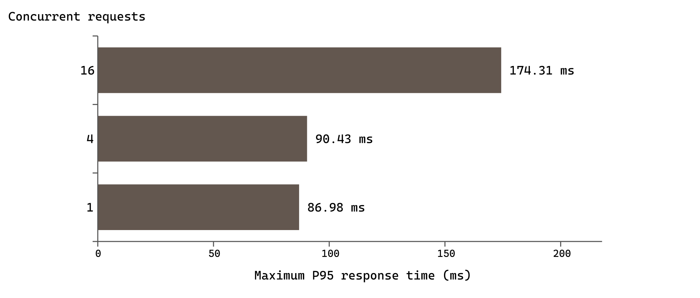

# 2026-11-03 脱敏验收证据

此目录对应当日未提交工作区的实际验证。结果用于任务书／开题报告整改及论文材料核对；不同测试单位分别统计，不合计成一个“总通过率”。账号、口令、令牌、数据库连接配置与私钥不收录。

| 证据 | 内容 |
| --- | --- |
| [后端测试](backend-summary.json) | 734 项实际执行，零失败／错误／跳过，含类级计数和独立 MySQL／Redis 条件 |
| [Node 回归](node-summary.json) | 214／214，与 JUnit 分开 |
| [设备结果](device-summary.json) | 完整同单 `CampusAcceptance`、登录、管理端及同日首轮审核，各 1／1；各自执行时间及原日志哈希 |
| [阶段日志摘录](device-stages.json) | 设备日志环形缓冲保留的末段，通过总数以设备运行摘要为准 |
| [设备截图](screenshots/) | 余额支付成功、商户已出餐、骑手送达和管理员部分退款成功；仅隔离环境合成数据 |
| [HTTP 交易](http-summary.json) | 同日首轮四角色与店铺审核事务场景；后端测试类可定位 |
| [容量测量](performance-large.json) | 500 店／14,971 商品／10,000 合成订单／20 账号，39 组 1,170 次逐次样本，零失败，最大 P95 174.31 ms |
| [Code Linter](codelinter-summary.json) | 0 error、48 warning、2 suggestion，保留规则与相对源码位置 |
| [论文审计](manuscript-audit.json) | 36 页，正文保守汉字计数 11,706，引用编号对应、目录更新、原稿哈希不变 |
| [文献核对](reference-verification.json) | 保留在线元数据请求实际结果及历史出版社资料依据 |
| [线上复核](online-summary.json) | 域名首页／脚本／540 店目录只读检查及脚本哈希 |
| [版本与产物](artifact-manifest.json)／[源文件哈希](source-hashes.json) | 基准提交、578 个代码／构建文件的原始字节哈希、正式 HAP 和隔离设备包哈希、论文哈希及执行条件 |

性能环境为 Windows 本机 HTTP 回环、JDK 25.0.2、MySQL 8.4.0、独立 Redis 5.0.14，缓存开启，应用堆 384 MiB、连接池 10。保留默认安全限流；浏览轮换 16 个真实认证的合成学生账号，私有接口使用所属账号。合成订单是查询规模夹具，不代表实际支付。骑手查询包括空结果，不能由此推断满载派单能力。未验证校园无线网、全校峰值、持续午餐高峰或正式外部渠道支付。

客户端测试使用 API 26 模拟器、独立包名和本机隔离后端。`CampusAcceptance` 的角色切换调用真实登录服务，业务操作通过实际页面处理器执行并读取服务端核对。定位权限预授权，角色切换清理测试遗留页面栈；未修改生产限流。正式 HAP 在测试构建后恢复正式包名和域名配置重建，仍是未签名 debug 产物。

本机原始日志及私有配置位于 `TemporaryCacheStorage/acceptance-final-20261103/`，首轮证据位于 `TemporaryCacheStorage/rectification-20261103/`；临时文件不属于可公开证据。独立环境复现可使用项目 Maven 测试、Node 测试和[设备实测指南](../../设备实测指南.md)，从私有本机配置注入隔离账号，不把口令写入源码。源文件哈希列表只涵盖代码和构建文件，不包含文档本身；论文与证据分别在产物清单登记。

论文原稿和导师确认文件保持不动，整改副本另存于本机论文目录。学校查重、人工评阅、真实签字和答辩不由此工程证据替代。
