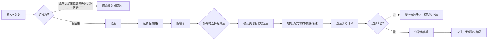
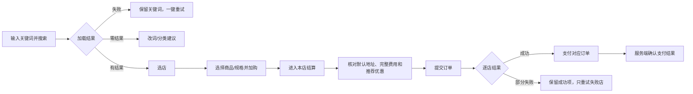
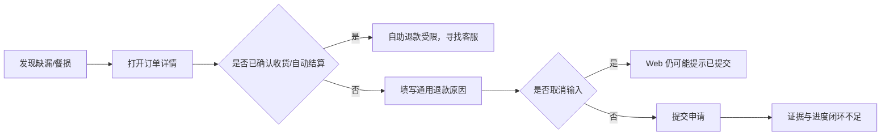
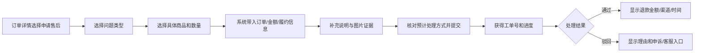

# 简单外卖：人性化改造诊断与实施方案

> 文档状态：诊断基线与实施主文档  
> 基线日期：2026-10-26  
> 覆盖范围：用户端、商家端、骑手端、平台运营端；HarmonyOS App 与 Web  
> 项目阶段：准备上线  
> 当前研究条件：暂无用户调研、投诉 Top 5 和关键指标基线
> 证据口径：问题表保留改造开始前的诊断基线；后续真实完成状态只以文末“实施记录”和验证证据为准

## 使用说明

本文档用于驱动后续逐项修改和验收。先修正“用户操作、页面反馈、服务端结果不一致”的任务阻断问题，再处理信息呈现、操作效率和体验增强。任何实现都必须继续遵守以下底线：

- 服务端是订单、资金、库存、地址、优惠券和权限的唯一业务权威，前端不得模拟成功结果。
- 下单初始为 `status=0` 待付款；支付后进入 `status=1`；商家接单进入 `status=2`；`readyTime` 区分制作中与已出餐待取餐；骑手取餐进入 `status=3`；送达进入 `status=4`。`status=4` 必须结合 `escrowStatus` 区分待确认和已完成；退款终态允许 `status=6 / escrowStatus=2`。
- 资金、库存、状态更新继续保留事务、条件更新、幂等和权限校验；多规格商品始终传 `specId`。
- 四端权限继续隔离；管理端不混入用户端导航；隐私、账号隔离和 401 清理规则不变。
- UI 延续暖白、深棕、陶橙、细描边与克制圆角，使用共享主题和 `PageHeader`，同步适配深色模式。

### 证据等级

| 标记 | 含义 | 本文如何使用 |
| --- | --- | --- |
| E | 代码直接证据 | 能从当前源码定位到触发条件或缺失逻辑，可直接进入修改与回归 |
| O | 页面观察 | 已从当前界面或可见交互观察到，但仍需设备或完整账号链路复验 |
| H | 待验证假设 | 基于外卖场景和人因规律推断，发生频率与用户影响需研究或埋点确认 |

代码行号用于定位当前基线，后续修改后可能变化；验收时应同时按文件、函数和业务场景查找。本文不会把 H 类判断写成已发生的投诉，也不会把建议目标写成当前指标。

### 优先级

| 优先级 | 判定 | 发布要求 |
| --- | --- | --- |
| P0 | 会选错对象、做错订单、阻断主履约或让用户误判真实结果 | 上线前修复；无法在期限内补齐的功能应关闭入口 |
| P1 | 影响金额、权益、售后、状态透明度、操作可达性或高频任务效率 | 上线前完成核心项，其余必须有明确人工兜底和排期 |
| P2 | 不阻断任务，但可减少重复操作、记忆负担或提升复购效率 | 有真实基线后按收益排序迭代 |

---

## 1. 一页诊断摘要

### 1.1 结论

当前最重要的问题不是视觉精致度，而是四端对同一订单的理解和动作尚未完全对齐。最高风险集中在五个交接点：选中哪家店、骑手能否取餐、商家能否看全备餐信息、多店提交后用户能否理解部分成功，以及自取入口是否对应一条完整履约链路。

项目已有一些正确基础，应保留并复用：App 店铺卡提前展示配送费和起送价；SKU 规格选择展示价格与库存；地址保存失败保留输入；结算页采用可滚动主体和底部操作区；支付结果由服务端确认；订单关键状态更新已有事务、条件更新和幂等保护。

### 1.2 Top 10 问题

排序依据为“任务影响 × 预计触发频率 × 修复成本优势”。由于没有真实运营数据，频率是待验证判断，不使用虚构分数。

| 排名 | 问题 | 直接后果 | 依据 | 成本判断 | 优先级 |
| --- | --- | --- | --- | --- | --- |
| 1 | Web 选择 B 店结算，确认页可能读取购物车第一家 A 店 | 用户确认和提交非预期店铺订单 | E：`server/takeout-gateway/src/main/resources/static/app.js:251`、`:257` | 低 | P0 |
| 2 | Web 骑手订单的“确认取餐”依赖接口未稳定提供的 `riderId` | 抢单后主履约路径无法继续 | E：`server/takeout-gateway/src/main/resources/static/app.js:274` | 低 | P0 |
| 3 | 商家 App 备餐卡未展示购买规格和用户备注 | 大小份、口味或忌口容易做错 | E：`entry/src/main/ets/pages/MerchantOrdersPage.ets:267` | 低 | P0 |
| 4 | App 多店订单部分成功时仍进入整体失败表达，全成功也只聚焦首单 | 用户不知道哪些订单已创建、哪些需要重试或支付 | E：`entry/src/main/ets/pages/CheckoutPage.ets:274` | 中 | P0 |
| 5 | 自取已有入口，但仍依赖配送地址、范围和普通配送状态机 | 用户被要求填写无关信息，自取单可能流入骑手链路 | E：`server/takeout-app/src/main/java/com/example/takeout/service/OrderService.java:246`、`:248` | 完整修复中高；关闭入口低 | P0 |
| 6 | 结算金额在双端存在缺项或预览口径偏差 | 用户需要心算，最终价格可能与预期不同 | E：`entry/src/main/ets/pages/CheckoutPage.ets:188`、`server/takeout-gateway/src/main/resources/static/app.js:259` | 中 | P1 |
| 7 | 确认收货会完成资金结算，结算后现有自助退款入口受限 | 用户先确认收到、后发现餐损或缺漏时缺少可执行路径 | E：`server/takeout-app/src/main/java/com/example/takeout/service/OrderService.java:825` | 中高 | P1 |
| 8 | Web 评价固定提交五星、固定标签和首个商品 | 用户表达被篡改，评价数据失真 | E：`server/takeout-gateway/src/main/resources/static/app.js:497` | 低 | P1 |
| 9 | Web 取消退款原因输入后仍提示“退款申请已提交” | 用户误以为平台已受理 | E：`server/takeout-gateway/src/main/resources/static/app.js:496` | 低 | P1 |
| 10 | App ETA 按下单后 30 分钟倒推且最低保持 5 分钟 | 延迟时持续给出无依据承诺，损害信任 | E：`entry/src/main/ets/pages/OrderDetailPage.ets:481` | 先移除错误承诺低；可靠 ETA 高 | P1 |

### 1.3 上线判断

- 第一批五项 P0 必须先形成可回归的完整改动；自取若无法补齐完整链路，MVP 直接关闭入口。
- 金额展示、评价真实性、退款反馈、错误 ETA、运营待办可达性属于上线前 P1，不宜用“后续优化”代替。
- 智能推荐、自动最优券、常点清单、拼单、跨店一体支付等属于增强能力，应在主路径正确、指标基线建立后再做。

---

## 2. 完整问题清单与逐层诊断

### 2.1 问题清单

#### A. 交易、选品与结算

| 编号 | 所属端/页面 | 现状与证据 | 用户代价 | 人性原理 | 可落地改造 | 优先级 | 验收标准 |
| --- | --- | --- | --- | --- | --- | --- | --- |
| UX-01 | 用户 Web／购物车、确认订单 | 点击店铺结算时有店铺 ID，但确认页从购物车首组读取商品。E：`server/takeout-gateway/src/main/resources/static/app.js:251`、`:257` | 选 B 得 A，需重新核对，最坏会错下单 | 一致性；错误预防；对象恒常性 | 将所选 `storeId` 写入路由状态，确认页、金额、优惠资格和提交都按该 ID 过滤；无效时回购物车并说明原因 | P0 | 两店购物车分别点 A/B，确认页标题、商品、费用、请求体和创建订单全部属于所选店；刷新后不得静默切店 |
| UX-04 | 用户 App／多店结算 | 客户端逐店创建订单；任一失败进入失败表达，成功订单缺少聚合结果入口。E：`entry/src/main/ets/pages/CheckoutPage.ets:244`、`:274` | 不知道哪些已下单、哪些待付款，可能重复提交 | 系统状态可见；识别优于回忆；容错 | 结果页按店展示“已创建待支付／失败／原因”；保留成功订单，只重试失败店；MVP 不要求新增后端批次表 | P0 | A 成功 B 失败时可直接支付 A、仅重试 B；全成功时每个订单均有入口；重试不重复创建成功订单 |
| UX-05 | 全端／到店自取 | 自取免配送费，但创建订单仍读取地址并校验配送范围；状态与骑手链路未完整分离。E：`server/takeout-app/src/main/java/com/example/takeout/service/OrderService.java:246`、`:248`、`:253` | 填写无关地址；到店后无法按真实语义完成订单 | 系统与现实匹配；最小必要输入；错误预防 | MVP 隐藏 App 与 Web 自取入口；后续补齐“选择门店→取餐时间→取餐码→商家核销／用户确认”再开放，骑手池必须排除自取 | P0 | MVP 所有正常入口不可选择自取；存量自取单有兼容提示；正式开放后无需配送地址、不进骑手池、配送费为 0、可独立完成 |
| UX-06 | 用户双端／费用与优惠 | App 用跨店总额初筛券、实际只给一个单店使用；Web 确认页缺少完整小计、配送费、优惠和应付汇总。E：`entry/src/main/ets/pages/CheckoutPage.ets:188`、`:268`；`server/takeout-gateway/src/main/resources/static/app.js:259` | 心算、反复检查；权益落差 | 认知卸载；价格透明；承诺一致 | 每个订单按服务端规则返回或复算只读预览；固定显示商品小计、配送费、优惠、应付；金额变化显示原因 | P1 | 两店各 ¥30 时“满 ¥50 减 ¥10”不得显示可用；页面应付与订单 `payAmount` 一致；所有金额变化有原因 |
| UX-11 | 用户 App／门店套餐 | 点击套餐价格区域会直接创建待付款订单。E：`entry/src/main/ets/components/store/StoreDetailContent.ets:182`、`:191`、`:541` | 查看价格可能变成下单，无法先核对地址和费用 | 可供性；知情操作；错误预防 | 价格只展示；增加明确“选套餐”按钮，加入统一购物车或结算；提交期间禁用重复触发 | P1 | 点击价格不建单；提交前可核对地址、费用和套餐明细；一次操作至多创建一单 |
| UX-12 | 用户双端／支付 | App 创建订单阶段显示“支付处理中”；Web 支付链接通过输入框交给用户，回流弱。E：`entry/src/main/ets/pages/CheckoutPage.ets:385`；`server/takeout-gateway/src/main/resources/static/app.js:492` | 混淆“订单已创建”和“钱已扣”；切换支付后不知道结果 | 阶段可见；匹配用户心智；闭环反馈 | 分开“正在提交订单”“订单已提交，待支付”“正在确认支付结果”；Web 提供二维码／打开支付页和结果查询；最终结果只认服务端 | P1 | 未扣款时不显示支付成功或处理中；成功、失败、取消、未知都能回到对应订单；重复查询不重复扣款 |
| UX-13 | 用户双端／地址 | 已有默认地址和手机号校验，但楼栋、楼层、门牌或取餐点缺少结构化提醒。E：`entry/src/main/ets/pages/AddressListPage.ets:544` | 地址看似完整却无法交付，增加电话沟通和取消 | 错误预防；识别优于回忆；就地校验 | 区分地图位置和详细门牌；提供示例；允许“无门牌”；超范围时给“更换地址”动作并保留结算输入 | P1 | 拒绝定位仍可手选；仅填大厦名时出现补充提示；改地址返回结算后备注、商品和优惠状态不丢 |
| UX-14 | 用户双端／搜索 | App 搜索失败返回空数组，易与零结果混淆；Web 搜索提交方式需补键盘回归。E：`entry/src/main/ets/service/api/CatalogApi.ets:234`、`:238` | 用户误以为平台没有商品并不断改词 | 准确归因；可恢复性；减少重复输入 | 独立“加载失败”和“没有结果”状态；保留关键词；提供重试；Web 使用标准搜索表单并支持 Enter | P1 | 断网和零结果文案不同；重试无需重输；Web 键盘可完成输入、提交、选择结果 |
| UX-15 | 用户双端／购物车 | 删除单项、整店或批量商品后只显示成功提示，没有撤销。E：`entry/src/main/ets/pages/CartPage.ets:286`、`:343` | 误触后要重新找店、规格和数量 | 用户控制与自由；可撤销性 | 单项删除后提供短时撤销；整店／批量删除明确范围，可采用一次确认或撤销；恢复时重新校验库存 | P2 | 撤销可恢复原规格和数量；库存不足时指出具体商品与可恢复数量；撤销不产生重复行 |
| UX-16 | 用户 App／再来一单 | 多商品逐项回购，部分成功后再次触发会继续增加已成功项。E：`entry/src/main/ets/pages/OrderDetailPage.ets:99`、`:1251` | 数量膨胀，用户需逐项检查删除 | 结果可预测；部分失败容错 | 展示已加购和未加购明细；只重试失败项；处理期间禁用按钮 | P1 | 一成一败后重试，成功商品数量不再增加；下架、缺货、规格失效分别说明 |
| UX-17 | 用户 App／优惠券 | 未选券时仅显示“请选择”，不说明可用数量和可省金额。E：`entry/src/main/ets/pages/CheckoutPage.ets:532`、`:544` | 用户需记住自己是否有券并逐张比较 | 识别优于回忆；合理默认；降低 Hick 选择成本 | 在修正资格口径后显示“有 N 张可用，最多省 ¥X”；推荐最低实付方案，同时保留“不使用” | P2 | 推荐结果与服务端应付一致；用户主动不用券后不被静默覆盖；不可用原因可见 |

#### B. 履约、收餐与售后

| 编号 | 所属端/页面 | 现状与证据 | 用户代价 | 人性原理 | 可落地改造 | 优先级 | 验收标准 |
| --- | --- | --- | --- | --- | --- | --- | --- |
| UX-02 | 骑手 Web／配送订单 | 取餐按钮显示依赖订单对象的 `riderId`；本人订单返回字段或身份判定不一致时按钮消失。E：`server/takeout-gateway/src/main/resources/static/app.js:274` | 抢单后无法继续履约 | 可操作性；即时反馈；权限与可见动作一致 | 本人配送列表按真实状态显示动作，后端继续校验所属骑手；骑手登录默认进入有效工作页 | P0 | Web 可完成登录→抢单→取餐→送达；其他骑手调用接口被拒绝；重复点击不重复推进 |
| UX-03 | 商家 App／备餐 | 卡片主要展示商品名、数量和状态，未把规格、备注、预约／配送方式作为备餐关键信息直接呈现。E：`entry/src/main/ets/pages/MerchantOrdersPage.ets:267`、`:320` | 需要猜测或跨页寻找，容易做错餐 | 信息外显；识别优于回忆；靠近任务呈现 | 在订单卡直接展示规格、数量、用户备注、配送方式和预约时间；无备注显示“无备注” | P0 | 大份／小份可区分；备注 App/Web 一致；商家无需进入其他页面即可完成备餐判断 |
| UX-07 | 用户端／确认收货、售后 | 确认收货释放托管；现有退款申请要求 `escrowStatus=0`。E：`entry/src/main/ets/pages/OrderDetailPage.ets:1222`；`server/takeout-app/src/main/java/com/example/takeout/service/OrderService.java:825` | 先确认收到、后发现缺漏时没有清晰自助路径 | 符合心智；知情操作；峰终体验 | 将“确认收到”和“是否可提交售后”分开定义；MVP 至少提供订单关联人工工单，规则确定后再做自动退款 | P1 | 手动或自动确认后，在有效政策期内仍有可执行入口；列表、详情和客服规则一致；资金操作幂等且不超额 |
| UX-08 | 用户 Web／评价 | 固定提交首个商品、5 星和“味道好”标签。E：`server/takeout-gateway/src/main/resources/static/app.js:497` | 用户意图被改写，评价数据无法用于决策 | 用户自主；数据真实性；可见控制 | 让用户选择商品、1–5 星、标签和文字；不预填赞美；取消不提交 | P1 | 选择 1 星保存为 1 星；负面文本不附加好评标签；多商品可选择对象；取消产生 0 次请求 |
| UX-09 | 用户 Web／退款反馈 | 取消或清空原因时不发送请求，但后续仍显示提交成功。E：`server/takeout-gateway/src/main/resources/static/app.js:496` | 误以为已受理并等待 | 反馈真实性；状态可见；错误恢复 | 取消立即返回且不提示成功；只有接口成功后显示受理结果和查看入口 | P1 | 取消产生 0 次请求、0 次成功提示；接口失败显示失败与重试；成功可从订单看到记录 |
| UX-10 | 用户 App／配送追踪 | 用下单时间和固定 30 分钟计算，最低显示 5 分钟。E：`entry/src/main/ets/pages/OrderDetailPage.ets:481`、`:492` | 无法合理安排等待，延迟时反复刷新 | 不确定性管理；可信反馈 | MVP 无可靠数据时显示真实阶段和更新时间；长期用出餐、骑手位置、距离和历史数据生成 ETA，并展示更新时刻 | P1 | 超时后不再固定承诺 5 分钟；定位过期标注更新时间；无 ETA 时明确“暂无法准确预计” |
| UX-18 | 全端／预约送达 | 服务端主要检查时间晚于当前时间，未体现营业时段、备餐提前量和运力容量。E：`server/takeout-app/src/main/java/com/example/takeout/service/OrderService.java:1237`、`:1254` | 用户将“可选”理解为平台承诺 | 预期一致；错误预防 | 能力不足时关闭预约；保留时由服务端返回可选时段，明确“期望送达”或“承诺送达”，并制定改期规则 | P1 | 不能选择过期／停业时段；预约信息到达商家和骑手；无法履约时给可执行替代方案 |
| UX-19 | 全端／取消规则 | 待接单、制作中、配送中的取消与库存回滚需要更细的阶段责任规则。E：`server/takeout-app/src/main/java/com/example/takeout/service/OrderService.java:754`、`:782` | 用户不知道能否退、退多少；商家和骑手成本归属不清 | 公平感；可预测性；知情决策 | 待支付直接取消；已支付按接单／制作／出餐／配送分层；已制作商品不应未经判断恢复可售库存 | P1 | 每阶段显示金额、责任和预计处理方式；重复取消不重复退款／回库；文案与服务端规则一致 |
| UX-20 | 用户端／客服、餐损缺漏 | 客服入口缺稳定承接；退款主要靠原因文本，缺订单关联证据和进度闭环。E：`entry/src/main/ets/pages/ContactCustomerServicePage.ets:49` | 异常时反复描述，离开页面后难追踪 | 错误恢复；减少重复表达；峰终体验 | 建订单关联工单；支持问题类型、具体商品、图片证据、联系偏好和进度；先用人工审核承接 | P1 | 餐损／缺漏可提交证据并获得申请编号；离开后可重进查看；驳回有理由和下一步 |
| UX-21 | 骑手双端／地址与联系 | App 长地址单行截断；Web 接单后必要联系信息和门店定位动作不足。E：`entry/src/main/ets/pages/RiderOrdersPage.ets:185` | 记地址、跨应用查找，增加错送和沟通成本 | 认知卸载；Fitts 定律；隐私渐进披露 | 接单后完整展示取送地址，提供复制、拨号和平台地图跳转；抢单前只展示距离和区域 | P1 | 三行长地址可完整查看；接单后可联系用户和找到门店；接单前不暴露电话及门牌 |

#### C. 商家、平台与全局可用性

| 编号 | 所属端/页面 | 现状与证据 | 用户代价 | 人性原理 | 可落地改造 | 优先级 | 验收标准 |
| --- | --- | --- | --- | --- | --- | --- | --- |
| UX-22 | 商家双端／缺货、拒单 | 主要动作是接单和出餐，缺货或临时无法营业缺少结构化处理。E：`entry/src/main/ets/pages/MerchantOrdersPage.ets:120`、`:333` | 商家无法主动终止异常，用户持续等待 | 用户控制；错误恢复；原因透明 | 待接单增加“无法接单”及原因；复用取消退款事务；制作后异常转平台工单 | P1 | 商家可说明缺货并结束未接订单；用户看到原因；资金、券、库存仅处理一次 |
| UX-23 | 平台 Web／退款动作 | 页面动作与后端允许状态存在错位风险，已送达订单不应误走直接退款接口。E：`server/takeout-gateway/src/main/resources/static/app.js:272`；`server/takeout-app/src/main/java/com/example/takeout/service/OrderService.java:801` | 运营点击必然失败或误用处理方式 | 错误预防；权限与状态一致 | 按订单状态和退款记录显示动作；未送达走取消退款，已送达走申请审批 | P1 | 所有可见按钮均能在该状态执行；已送达不会误调用直接取消；越权请求被拒绝 |
| UX-24 | 平台 Web／待处理列表 | 退款等运营列表存在固定数量加载、缺少可靠分页和待办总量的风险。E：`server/takeout-gateway/src/main/resources/static/app.js:358` | 第 101 条以后可能不可达，产生超时工单 | 待办可见；任务优先；外部记忆 | 默认筛待审批；接分页并显示总量；支持订单号定位、处理时间排序 | P1 | 第 101 条待审记录可找到；总数与服务端一致；刷新不丢当前筛选和页码 |
| UX-25 | 双端／可达性 | Web 弹层需验证焦点约束；App 部分高频图标按钮为 32×32。E：`server/takeout-gateway/src/main/resources/static/index.html:41`；`entry/src/main/ets/pages/RiderOrdersPage.ets:190` | 键盘用户迷失，触屏误点 | WCAG；Fitts 定律；焦点可预测 | Web 使用原生对话框或完整焦点管理；移动高频点击热区至少 44×44，视觉图标可保持较小 | P1 | 弹层打开聚焦内部、Tab 不进入背景、关闭恢复焦点；关键按钮热区 ≥44×44 且不重叠 |
| UX-26 | 双端／视觉与深色 | App 有主题基础；Web 部分小号主按钮和深色状态的文字对比需提高。E：`server/takeout-gateway/src/main/resources/static/index.html:9`、`:17` | 弱视、户外和暗光环境辨认困难 | 感知辨识；冗余编码；WCAG | 保留品牌色，用更深文本色或更浅背景；选中状态同时使用勾选、文字和颜色；检查 200% 字号 | P1 | 普通文字对比度 ≥4.5:1；大文本和图形 ≥3:1；明暗模式及 200% 字号下关键操作不丢失、不遮挡 |
| UX-27 | 用户、商家、骑手／偏好与说明 | 餐具、口味、无接触配送等主要依赖自由备注，缺少稳定偏好与角色分发。E：`entry/src/main/ets/pages/CheckoutPage.ets:604` | 重复输入；接收方需从长文本判断 | 合理默认；减少重复输入；信息按角色分发 | 先做可编辑快捷项；常用偏好按账号保存；配送说明只发骑手，口味和餐具只发商家 | P2 | 偏好可随单修改且按账号隔离；商家／骑手只看到相关字段；不把未支持服务展示成承诺 |

### 2.2 用户旅程地图

下表以普通外卖用户为主线。情绪是待调研假设，用于确定需要减少的不确定性，不代表已有访谈结论。

| 阶段 | 用户目标 | 当前关键动作 | 预期情绪 | 主要摩擦 | 对应改造 |
| --- | --- | --- | --- | --- | --- |
| 发现 | 快速找到能送、合口味、价格合适的店 | 定位、搜索、浏览店铺 | 期待、轻松 | 搜索失败与零结果混淆；地址范围后置 | UX-13、UX-14；先说明配送可达性和失败原因 |
| 决策 | 比较起送价、配送费、销量、预计时间 | 看店铺卡和详情 | 犹豫、比较 | ETA 可信度不足；费用口径不完整 | UX-06、UX-10；信息在决策前出现 |
| 选品加购 | 选对规格、数量和套餐 | 打开规格、加购、看购物车 | 专注 | 套餐价格可触发下单；删除不可撤销 | UX-11、UX-15；动作名称表达后果 |
| 结算支付 | 核对地址、费用和优惠，一次成功下单 | 选地址、配送方式、券、备注、提交、支付 | 谨慎 | 多店对象错位；部分成功不透明；自取链路不完整 | UX-01、UX-04、UX-05、UX-06、UX-12 |
| 等餐追踪 | 知道谁在处理、还要多久、延迟怎么办 | 看订单状态、地图、联系商家／骑手 | 等待、焦虑 | 固定 ETA；状态原因不透明 | UX-10、UX-21；用真实阶段和更新时间管理不确定性 |
| 收餐 | 顺利找到餐并确认收到 | 联系骑手、确认收货 | 放松 | 地址／联系信息不完整；确认收货与售后心智冲突 | UX-07、UX-21 |
| 售后评价 | 低成本说明缺漏、餐损或评价真实体验 | 退款、举证、查看进度、评价 | 出问题时挫败 | 取消仍提示成功；缺证据与工单；固定五星 | UX-07、UX-08、UX-09、UX-20 |
| 复购 | 快速重买仍可售商品 | 收藏、再来一单、常点 | 熟悉、省心 | 部分加购后重试会重复；失效商品解释不足 | UX-16、UX-17、UX-27 |

### 2.3 四端服务交接

外卖体验由四端共同完成，任何一端“看不见”都会在下一端变成电话、取消或投诉。

| 交接点 | 用户端需要知道 | 商家端需要知道／执行 | 骑手端需要知道／执行 | 平台端责任 |
| --- | --- | --- | --- | --- |
| 下单 | 店铺、商品、规格、金额、地址是否正确 | 完整商品、规格、备注、期望时间 | 无 | 校验权限、价格、库存、范围和幂等 |
| 支付后 | 已支付、等待商家接单 | 接单或说明无法接单 | 无 | 托管资金、超时与退款一致 |
| 备餐 | 制作中／已出餐，不虚构分钟数 | 按规格备注制作并标记出餐 | 只在可抢阶段看到必要信息 | 保证状态和通知可追踪 |
| 配送 | 骑手、阶段、位置更新时间、联系入口 | 骑手是否已接单／取餐 | 完整取送地址，取餐和送达动作 | 保护隐私、校验骑手归属和状态流转 |
| 收餐 | 确认收到的后果、售后入口 | 订单是否完成 | 送达结果 | 结算与售后资格分离表达 |
| 异常 | 原因、证据要求、进度、下一步 | 缺货／餐损责任与处理 | 错送／无法联系的上报入口 | 统一工单、资金与责任判定 |

### 2.4 核心订单状态的人性化表达

MVP 不需要为了文案新增状态码，但必须把相同数字状态下的重要阶段区别展示出来。

| 服务端条件 | 用户端文案 | 商家端动作／文案 | 骑手端动作／文案 | 异常出口 |
| --- | --- | --- | --- | --- |
| `status=0` | 待支付；显示剩余支付时间 | 待付款，不进入备餐 | 不可见 | 用户取消；超时自动取消并释放占用 |
| `status=1` | 已支付，等待商家接单 | 接单／无法接单 | 不可见 | 超时提醒；取消按政策处理 |
| `status=2` 且无 `readyTime` | 商家备餐中 | 出餐完成 | 不进入待取餐动作 | 缺货／制作异常转平台处理 |
| `status=2` 且有 `readyTime`、无骑手 | 商家已出餐，等待骑手接单 | 已出餐，等待骑手 | 抢单池可见 | 运力不足提示与平台介入 |
| `status=2` 且有 `riderId` | 骑手已接单，前往取餐 | 骑手已接单，等待取餐 | 确认取餐 | 无法取餐上报 |
| `status=3` | 配送中；显示位置更新时间 | 骑手配送中 | 确认送达 | 无法联系、地址异常、事故上报 |
| `status=4, escrow=0` | 已送达，待确认；可提交符合政策的异常 | 已送达，待确认 | 已送达 | 确认收货或售后申请并发只能一方成功 |
| `status=4, escrow=1` | 已完成；可评价、复购；售后按政策进入工单 | 已结算 | 收入已记录 | 不再走普通取消，走售后工单／审批 |
| `status=6, escrow=2` | 已退款；显示金额、渠道和时间 | 已退款 | 按责任规则显示 | 不允许重复退款 |

到店自取在完整独立状态与核销动作落地前不开放。若后续沿用现有数字状态，必须用 `deliveryType=PICKUP` 明确屏蔽骑手动作，并定义“待取餐、已取餐”的唯一完成条件。

### 2.5 认知负荷诊断

| 维度 | 诊断 | 人性依据 | 改造原则 |
| --- | --- | --- | --- |
| 信息密度 | 关键费用和履约信息没有始终靠近决策点；部分页面反而需要用户跨页找信息 | 人的工作记忆有限，任务信息应外显 | 金额放提交按钮上方；规格和备注放备餐卡；配送阶段放订单首屏 |
| 选项数量 | 优惠券、备注、预约、自取等同时出现，但部分能力尚不完整 | Hick 定律：选项越多，判断越慢 | 默认折叠低频项；未完成能力不展示；推荐方案仍保留退出权 |
| 记忆负担 | 多店提交、再来一单、退款和追踪要求用户记住上一屏或之前成功项 | 识别优于回忆 | 结果页逐项列状态；重试只针对失败项；展示更新时间和处理记录 |
| 术语 | “支付处理中”被用于订单创建；数字状态背后的托管差异不对用户解释 | 系统语言应匹配现实任务 | 使用“正在提交订单”“待支付”“已送达，待确认”等阶段语言 |
| 层级 | Web 确认页费用汇总弱；异常入口和下一步不突出 | 视觉层级应反映任务优先级 | 首屏只突出一个主动作；状态、金额和异常出口形成固定阅读顺序 |

### 2.6 交互逻辑审查

| 检查项 | 结论 | 主要问题 | 实施要求 |
| --- | --- | --- | --- |
| 可达性／拇指热区 | 有问题 | 32×32 高频按钮偏小，Web 弹层焦点需补齐 | 移动热区至少 44×44；主操作位于底部稳定区域；Web 可全键盘操作 |
| 即时反馈 | 有问题 | 部分动作显示了与实际请求结果不一致的成功反馈 | 成功提示只能由成功响应触发；未知结果显示“正在确认”并允许查询 |
| 可撤销性 | 建议改造 | 购物车删除、批量操作缺撤销 | 可逆动作优先提供撤销；不可逆动作说明后果和对象 |
| 一致性 | 有问题 | App 与 Web 在评价、金额、骑手动作等语义不同 | 建立同一状态到四端文案和动作矩阵；接口规则优先于页面猜测 |
| 系统状态可见性 | 有问题 | 多店部分成功、ETA、退款进度不透明 | 展示阶段、对象、更新时间、失败原因和下一步 |
| 容错 | 有问题 | 地址细节、部分成功、重复触发和失效 SKU 的恢复不足 | 保留输入；幂等；只重试失败项；错误定位到具体商品／店铺／字段 |

### 2.7 UI 视觉层诊断

- 信息优先级：每个任务页遵循“当前状态 → 核心对象 → 金额／时效 → 主动作 → 次要详情”。订单状态和应付金额不能埋在长内容底部。
- 可读性：正文建议不低于现有 `FONT_SIZE.MD`；辅助文字仍需满足 4.5:1 对比度。颜色不作为唯一状态信号。
- 热区：移动端主按钮、加减、取餐、送达、关闭弹层的点击区域至少 44×44；相邻危险操作留出间距。
- 动效：只用于解释状态变化，例如加入购物车、删除后撤销、提交中锁定；不使用仅装饰且延迟任务的动画。
- 深色模式：沿用 `AppTheme` 语义色；逐项检查禁用、选中、警告、退款和成功状态，不能只反转背景。
- 放大与长文本：200% 字号、长店名、长地址、长规格、三行备注下不能遮挡底部提交按钮。

### 2.8 业务逻辑人性化诊断

| 能力 | 当前判断 | 人性化规则 |
| --- | --- | --- |
| 默认地址 | 基础合理 | 只在仍可配送时默认选中；不可达时说明并引导更换，不静默换地址 |
| 餐具、口味、无接触配送 | 建议改造 | 提供快捷项但每单可改；按角色分发，避免商家和骑手筛长备注 |
| 最少步骤路径 | 有问题 | 单店正常下单应无需重复确认已知信息；多店必须以正确结果为先，不能为少一步隐藏部分成功 |
| 凑单 | 建议改造 | 只在未达起送价时展示“还差 ¥X”，优先推荐当前店低价可售商品，不用倒计时或强迫式弹窗 |
| 优惠券 | 有问题 | 资格和金额先由服务端统一；可以推荐最省方案，但保留“不使用”并解释不可用原因 |
| 状态透明 | 有问题 | 只展示有依据的阶段、位置和时间；未知就是未知，不能用固定 5 分钟制造确定感 |
| 异常兜底 | 有问题 | 缺货、延迟、餐损、缺漏、错送、退款都需订单关联入口、处理编号、状态和下一步 |
| 减少重复输入 | 建议改造 | 地址、偏好和联系设置按账号保存；售后自动带订单、商品、金额，用户只补问题和证据 |

### 2.9 异常与边缘场景清单

| 场景 | 必须处理的系统行为 | MVP 策略 | 后续能力 |
| --- | --- | --- | --- |
| 定位漂移／拒绝定位 | 允许手选地址，不覆盖用户已选地址 | 地址选择和配送范围明确反馈 | 地址置信度和地图纠偏 |
| 只有大厦名、无楼层门牌 | 就地提醒但允许“无门牌／前台取” | 详细地址示例与快捷说明 | 楼栋、门牌结构化字段 |
| 两店购物车 | 每次结算对象不串店 | 单店结算 + 正确店铺状态 | 多店结果聚合、批次跟踪 |
| 多人拼单 | 未建立参与人、结算和取消规则时不展示 | 关闭 | 明确发起人、锁单、代付和退出规则后再做 |
| 跨店下单 | 一店一订单、一店一金额、一店一结果 | 逐店提交并展示结果 | 批次号和统一支付需后端产品设计 |
| 预约单改期 | 无容量模型时不承诺 | 关闭或仅标为需商家确认 | 可售时段、容量、改期和补偿规则 |
| 支付失败／回流丢失 | 订单保留待支付，结果以服务端为准 | 查询状态、可重新支付 | 支付回流监测和自动提醒 |
| 骑手联系不上用户 | 保护隐私并留处理记录 | 拨号／平台工单入口 | 隐私号、等待计时与责任规则 |
| 餐品缺失、餐损 | 支持按问题、商品和证据提交 | 订单关联人工工单 | 按件退款、规则化自动审核 |
| 商品下架／规格变更 | 指明具体商品，只重试可恢复项 | 再来一单结果明细 | 相似替代推荐 |
| 优惠券并发失效 | 不静默提高价格后提交 | 提交前重新计价并要求确认变化 | 锁券和短期价格快照 |
| 商家已出餐后取消 | 不自动把成品当可售库存恢复 | 转人工／平台判定 | 责任、补偿和库存模型 |

### 2.10 外卖重点检查清单

| 检查项 | 结论 | 结论依据 | 首要动作 |
| --- | --- | --- | --- |
| 定位与地址 | 有问题 | 有默认地址和基础校验，但楼层门牌、范围纠错与返回结算闭环不足 | 拆分地图位置与详细门牌；超范围提供“更换地址” |
| 起送价与配送费 | 建议改造 | App 店铺卡前置展示是合理基础，Web／确认页金额汇总仍不完整 | 选品前展示；结算固定显示差额和费用组成 |
| 菜单与 SKU | 有问题 | 普通多规格逻辑较完整，套餐点击直接建单破坏可预期性 | 套餐进入统一结算；所有价格变化即时反馈 |
| 购物车 | 有问题 | 多店对象可能错位，删除不可撤销 | 先修正确店结算，再补撤销和按店结果 |
| 优惠 | 有问题 | 跨店资格和单店实际使用口径不一致 | 服务端统一试算；显示最省方案和不可用原因 |
| 结算页 | 有问题 | 自取、费用、多店结果存在断点 | 关闭不完整入口；统一核对卡与逐店结果 |
| 支付与状态 | 有问题 | 提交订单和支付概念混淆，Web 回流弱 | 分阶段文案；服务端查询支付终态 |
| 配送追踪 | 有问题 | 固定算法 ETA 不可信，位置新鲜度不足 | MVP 展示真实阶段和更新时间；长期再做 ETA |
| 收餐与售后 | 有问题 | 确认收货后售后心智冲突，餐损／缺漏举证弱 | 建订单工单，明确确认收货后仍可申请的政策 |
| 复购 | 建议改造 | 有再来一单基础，但部分成功重试可能重复 | 只重试失败项，显示商品变更 |
| 商家端 | 有问题 | 备餐信息不全，缺货处理弱 | 卡片展示规格备注；补“无法接单”原因 |
| 骑手端 | 有问题 | Web 取餐动作阻断，地址和联系成本高 | 修复状态动作；接单后完整展示取送信息 |

---

## 3. 关键流程改造前后对比

### 3.1 计数口径

- “步骤”按一次有明确目的的页面动作计数；连续填写同一表单按一个步骤计。
- “决策点”指用户必须比较或判断后才能继续的节点；系统可根据既有信息正确默认的，不应继续转嫁给用户。
- 数字是基于当前界面的任务模型，不是实测指标。上线前需用 5–8 名目标用户完成任务测试校正。
- 支付平台内部操作不计入本项目点击数，但从支付平台回到订单并确认结果计入闭环。

### 3.2 搜索 → 下单 → 支付主路径

#### 当前路径

单店理想成功任务约 10 个步骤、8 个显式决策点；多店路径增加店铺和失败判断，而且可能无法正确完成。主要问题不是点击多，而是对象、金额和结果缺乏确定性。

#### 目标路径

目标为单店 8 个步骤、5 个显式决策点；默认地址、最省优惠和即时配送由系统在规则正确时提供默认，用户只需核对。多店仍是一店一订单，但结果聚合展示，不要求用户记住之前成功项。

| 对比点 | 改造前 | 改造后 | 验收 |
| --- | --- | --- | --- |
| 搜索失败 | 与零结果都像“没有店” | 失败、零结果、正常结果三态 | 三种状态可稳定复现且文案不同 |
| 结算对象 | 店铺选择可能丢失 | `storeId` 贯穿确认和提交 | 店名、商品、金额、请求体 100% 同店 |
| 费用 | 用户需要补充心算 | 小计、配送、优惠、应付固定汇总 | 页面与服务端金额一致 |
| 优惠 | 用户自己找，资格口径偏差 | 推荐最低实付，可主动不用 | 推荐和最终订单一致 |
| 多店结果 | 整体成功／失败表达 | 每店独立结果和动作 | 成功项可支付，失败项可单独重试 |
| 支付 | 创建和支付文案混淆 | 创建、待支付、确认结果分阶段 | 未付款绝不显示已支付 |

### 3.3 异常售后路径

#### 当前路径

当前可见提交约 5 个步骤、4 个决策点，但部分场景没有可完成的闭环。这里不能用“步骤少”判断好坏，因为少的是必要的证据、状态和恢复入口。

#### 目标路径

目标提交路径约 6 个步骤、3 个决策点。虽然动作数略增，但任务完成从“部分场景无终点”变为可追踪闭环，且订单、金额和商家等信息由系统自动带入，不要求重复描述。

| 对比点 | 改造前 | 改造后 | 验收 |
| --- | --- | --- | --- |
| 入口 | 受结算状态限制，规则难理解 | 订单详情始终有符合政策的处理入口 | 有效政策期内入口一致 |
| 描述问题 | 通用自由文本 | 类型 + 商品 + 数量 + 补充说明 | 运营无需再次询问订单和商品 |
| 举证 | 弱或缺失 | 图片、文字和履约时间自动关联 | 上传失败可重试且不丢已填内容 |
| 提交反馈 | 取消也可能提示成功 | 仅成功响应显示工单号 | 取消 0 请求；失败不显示成功 |
| 进度 | 离开后难追踪 | 待处理、处理中、通过、驳回、已退款 | 状态、时间、处理人／规则可查 |
| 资金 | 用户难理解 | 显示退款金额、渠道和预计到账 | 不超额、不重复、与支付渠道一致 |

---

## 4. UI 层具体建议与可上线文案

### 4.1 页面信息层级

#### 用户端

- 店铺列表：店名和主营信息为一级；评分、月售为二级；起送价、配送费、可达性和可信 ETA 与决策同时出现。
- 商品页：商品名和实际到手价为一级；规格、库存、描述为二级；“加入购物车”是唯一主动作。套餐价格不是按钮。
- 购物车：按店分组；每组固定展示店铺小计、起送差额和“去结算”；全局总价只用于理解，不用于跨店券资格。
- 结算页：地址／取餐方式 → 时间 → 商品 → 优惠 → 备注偏好 → 费用汇总 → 提交。低频发票和说明折叠，但异常提示不折叠。
- 订单详情：状态和下一步在首屏；地图是状态证据之一，不能替代文字阶段和更新时间。

#### 商家端

- 待处理按“新订单、制作中、已出餐”等任务分区，不只依赖颜色。
- 订单卡首屏展示商品、规格、数量、备注、预约时间；金额和顾客隐私信息降低层级。
- 危险动作“无法接单”与主动作“接单／出餐”保持空间分离，并要求原因。

#### 骑手端

- 抢单前：门店区域、送达区域、距离、预计收入、商品体量和预约属性；隐藏用户电话和详细门牌。
- 接单后：当前唯一下一步、完整取送地址、联系和导航；取餐与送达按钮不同时出现。
- 行驶中避免长表单；异常上报使用大热区的预设原因。

#### 平台运营端

- 默认进入“待处理”，按超时风险排序；显示总数、筛选、分页和订单号搜索。
- 审批面板同时展示订单、支付、商家／骑手履约、用户证据和历史处理，避免跨页拼信息。

### 4.2 组件要求

| 组件 | 具体要求 | 原因 |
| --- | --- | --- |
| 费用汇总 | 四行固定结构：商品小计、配送费、优惠、应付；应付字号最高 | 将计算交给系统，降低工作记忆负担 |
| 状态步骤条 | 只展示真实完成阶段；异常原因插入当前阶段，不伪造未来时间 | 系统状态可见，减少等待焦虑 |
| 底部操作区 | 一个主动作，次动作降级；长内容使用 `layoutWeight(1)` 滚动 | 拇指可达、避免按钮被挤出屏幕 |
| 删除反馈条 | “已移除 ××” + “撤销”，停留 4–6 秒 | 可恢复比二次确认更适合高频可逆动作 |
| 表单错误 | 靠近字段，说明原因和修正方式，保留输入 | 降低搜索错误和重复输入成本 |
| 异常工单卡 | 问题类型、商品、状态、更新时间、下一步 | 让用户无需记住客服沟通内容 |
| 图标按钮 | 使用项目已有图标；有无障碍名称；热区 ≥44×44 | Fitts 定律和屏幕阅读器可用性 |
| 弹层 | 标题说明任务；打开后焦点进入，关闭后回原触发点 | 键盘路径连续，避免焦点迷失 |

### 4.3 可直接上线的微文案

| 场景 | 标题／主文案 | 操作或辅助文案 |
| --- | --- | --- |
| 搜索加载失败 | “暂时无法加载搜索结果” | “请检查网络后重试。你的搜索词已保留。”；按钮“重新加载” |
| 搜索零结果 | “没有找到“{关键词}”相关结果” | “试试店铺名、菜品名，或查看附近分类。” |
| 地址缺门牌 | “请补充楼栋、楼层或门牌” | 示例：“3 栋 1206，东门进入”；选项“此地址无需门牌” |
| 地址超范围 | “该地址暂不在配送范围内” | 按钮“更换地址”；辅助“购物车商品和备注会为你保留” |
| 未达起送价 | “还差 ¥{差额} 起送” | 按钮“去凑单”；不使用“马上就亏”“最后机会”等压力文案 |
| 优惠已推荐 | “已为你选择最省方案，已减 ¥{金额}” | 次入口“更换优惠券”；选项“不使用优惠券” |
| 优惠失效 | “优惠条件已变化，应付增加 ¥{差额}” | 按钮“查看费用”“确认并继续”；不得静默提交 |
| 创建订单 | “正在提交订单…” | “请勿重复操作”；完成前禁用主按钮 |
| 创建完成待支付 | “订单已提交，待支付 ¥{金额}” | 按钮“立即支付”；辅助“请在 {时间} 前完成支付” |
| 多店全部成功 | “{数量} 家店的订单已提交” | 每店按钮“支付 ¥{金额}”或“查看订单” |
| 多店部分成功 | “{成功数} 家已提交，{失败数} 家未提交” | “已提交的订单不会重复创建。”；按钮“重试失败店铺” |
| 自取入口关闭 | 正常入口直接隐藏 | 存量／深链提示：“到店自取暂未开放，请选择外卖配送。” |
| 支付结果未知 | “正在确认支付结果” | “请不要重复支付，可稍后刷新订单状态。”；按钮“查询结果” |
| 商家无备注 | “用户备注：无” | 不留空白，不要求商家猜测是否加载失败 |
| 商家有备注 | “用户备注：少辣，不要香菜” | 规格紧邻商品名：“大份 ×2” |
| 商家无法接单 | “请选择无法接单的原因” | 选项“商品售罄”“即将打烊”“设备故障”“其他”；按钮“确认并通知用户” |
| 等待骑手 | “商家已出餐，正在等待骑手接单” | “我们会持续为你匹配骑手。” |
| ETA 不可靠 | “配送中，暂时无法准确预计送达时间” | “位置更新于 {HH:mm}”；按钮“联系骑手”“需要帮助” |
| 确认收货 | “确认已经收到餐品？” | “确认后订单款项将结算；如有缺漏或餐损，请先申请售后。”；按钮“确认收到” |
| 删除商品 | “已移除「{商品名}」” | 按钮“撤销” |
| 再来一单部分成功 | “已加入 {成功数} 件，{失败数} 件需要处理” | “{商品名} 已售罄”；按钮“只重试失败商品” |
| 退款取消输入 | 不显示 Toast | 直接返回原页面，保留原订单状态 |
| 售后提交成功 | “售后申请已提交” | “申请编号：{编号}”；按钮“查看处理进度” |
| 售后提交失败 | “申请未提交” | “已填写内容会保留，请稍后重试。”；按钮“重新提交” |
| 售后驳回 | “本次申请未通过” | “原因：{原因}”；按钮“补充材料”或“联系平台客服” |
| 退款完成 | “退款已原路退回 ¥{金额}” | “处理时间：{时间}；到账时间以支付渠道为准。” |
| 运营空待办 | “当前没有待审批退款” | “新申请会显示在这里。” |

### 4.4 无障碍与响应式验收

- 普通文字与背景对比度至少 4.5:1；大号文字、图标和控件边界至少 3:1。
- 所有交互元素可通过键盘到达，焦点顺序与视觉顺序一致，焦点样式始终可见。
- 弹层打开时焦点进入弹层并限制在其中，关闭后回到触发按钮；Esc 可关闭非强制弹层。
- 图标按钮提供可读名称，状态不能只靠颜色；错误同时有文字、位置和必要图标。
- 320px 宽 Web、普通手机和 200% 字号下，长地址、金额、按钮文案不重叠；底部主动作始终可达。
- 加载、空状态、失败、无权限、已下架、重复操作六类状态均有明确文案和可执行下一步。

---

## 5. 分阶段落地计划、依赖与度量

### 5.1 MVP：1–2 周

#### 第一批：P0 主链路正确性

| 顺序 | 目标 | 涉及范围 | 实施要点 | 验证 |
| --- | --- | --- | --- | --- |
| 1 | 修复 Web 错店结算 | Web 购物车、确认页、下单请求 | `storeId` 从触发动作贯穿商品过滤、标题、费用和提交 | 两店交叉用例；刷新／返回用例；请求体核对 |
| 2 | 修复 Web 骑手取餐 | Web 配送订单、后端权限契约 | 本人订单按状态显示动作，服务端校验所属骑手 | 抢单→取餐→送达；他人订单越权；重复点击 |
| 3 | 补齐商家备餐信息 | 商家 App，必要时同步 Web | 显示规格、数量、备注、配送方式和预约时间 | 多规格、有／无备注、长备注、预约单 |
| 4 | 改造 App 多店结果反馈 | App 结算与结果页 | 每店记录成功／失败和订单 ID；只重试失败项 | 全成功、部分成功、全失败、重试和连点 |
| 5 | 暂时关闭自取入口 | App 与 Web 所有正常入口 | 隐藏入口；存量订单兼容；服务端仍防止错误流入骑手池 | 新用户看不到入口；深链有明确提示；配送不受影响 |

#### 第二批：上线前高风险 P1

- 补全 Web／App 费用汇总和服务端一致性，修复优惠资格口径。
- 修复 Web 评价真实输入和退款取消误报。
- 移除固定 5 分钟 ETA，改为真实阶段与更新时间。
- 修正平台退款动作条件和待办分页。
- 修正“支付处理中”等阶段文案，补支付未知状态查询。
- 完成关键弹层焦点、44×44 热区和文字对比快速整改。

### 5.2 迭代：3–6 周

- 建立订单关联售后工单：问题类型、商品、证据、进度、驳回理由和退款结果。
- 明确确认收货后的售后有效期，并让自动确认与手动确认使用同一政策。
- 增加商家无法接单／缺货处理及平台介入路径。
- 完善地址详细信息、骑手取送信息和隐私渐进披露。
- 改造再来一单的部分失败结果，补购物车撤销。
- 服务端提供订单试算或共享计价结果，支持正确的推荐优惠。
- 建立埋点和真实基线，开展首轮可用性测试和客服问题编码。

### 5.3 长期：6 周以后

- 可靠 ETA：结合门店备餐、骑手位置、距离、时段和历史履约；达不到准确性门槛时不展示分钟数。
- 预约单：营业时段、备餐提前量、商家容量、运力容量、改期和补偿规则齐全后开放。
- 到店自取：独立核销码、取餐状态、通知、超时和售后规则齐全后重新开放。
- 按件售后、责任判定和规则化自动审核；高风险订单继续人工审核。
- 常点清单和偏好分发；基于真实行为做推荐，不以干扰主任务的弹窗促销。
- 多人拼单、跨店统一支付只在参与人、支付、退款、取消和幂等模型完整后评估。

### 5.4 依赖与风险

| 依赖／风险 | 影响 | 处理方式 |
| --- | --- | --- |
| 暂无用户调研与投诉数据 | 无法判断问题真实频率和人群差异 | 先修代码证实的正确性问题；上线灰度后建立埋点、客服标签和访谈 |
| 暂无指标基线 | 不能承诺转化率或取消率下降固定百分比 | 发布前采 1–2 周基线或使用受控测试；功能正确性使用 100% 场景验收 |
| 取消、售后、超时赔付政策未定 | 文案、接口和资金逻辑无法最终定稿 | 产品、运营、财务先确定状态 × 责任 × 金额矩阵；未定前走人工工单 |
| 可靠 ETA 数据源不足 | 分钟承诺可能继续误导 | MVP 只展示真实阶段；满足准确度门槛后再启用 ETA |
| 预约和自取能力不完整 | 入口会制造无法履约的承诺 | 入口保持关闭，不能用说明文字代替完整状态机 |
| App 与 Web 独立实现 | 同一业务可能再次出现语义偏差 | 建共享状态／文案矩阵和跨端契约用例；每项同时检查两端 |
| 真实支付未完成本次验收 | 沙箱成功不等于正式渠道可用 | 正式渠道在发布清单单独验收成功、失败、取消、回调、重复通知和退款 |
| 工作区已有其他改动 | 修改时容易误覆盖无关工作 | 每批只改目标文件，先读当前差异；不回退未知改动 |

### 5.5 指标与验收标准

#### 上线门禁：无需历史基线

| 指标 | 定义 | 验收目标 |
| --- | --- | --- |
| 结算店铺一致率 | 确认页／请求／订单店铺与用户点击结算店一致 | 自动化与手工场景 100% |
| 骑手主路径完成率 | 合法骑手从抢单到取餐、送达的测试任务完成 | 关键状态组合 100%，越权 100% 拒绝 |
| 备餐信息完整率 | 商家卡片正确展示商品、规格、数量、备注、方式和预约 | 有数据字段 100% 展示正确；无数据有明确空值 |
| 多店结果可解释率 | 每个店铺都有成功／失败、原因和下一步 | 全成功、部分成功、全失败场景 100% |
| 自取错误暴露率 | 未完成链路仍被新用户选择的比例 | 0% |
| 金额一致率 | 前端应付与服务端订单 `payAmount` 一致 | 测试矩阵 100%，精确到分 |
| 反馈真实性 | 未发送／失败请求被提示成功的比例 | 0% |
| 评价意图一致率 | 保存商品、星级、标签与用户输入一致 | 测试矩阵 100% |
| 核心可达性 | 键盘、焦点、热区、对比和 200% 字号 | 本文 4.4 全部通过 |

#### 有基线后评估的产品指标

| 指标 | 建议口径 | 第一阶段目标 |
| --- | --- | --- |
| 搜索到支付成功任务完成率 | 发起搜索后 30 分钟内成功支付且未因系统错误取消 | 建立基线后提升 ≥10%，并分 App/Web 观察 |
| 单店下单操作步骤 | 按 3.1 口径录屏计数 | 典型任务从模型 10 步降到 ≤8 步，决策点降到 ≤5 |
| 结算放弃率 | 进入确认页但 30 分钟内未创建订单 | 建立基线后下降 ≥15%，同时监控误下单和取消不得上升 |
| 地址问题取消率 | 取消原因为无法找到／地址不完整／超范围 | 建立基线后下降 ≥30% |
| 部分成功后的重复订单率 | 多店部分成功后，同用户同店同商品短时间重复创建 | <0.1%，目标为 0 |
| 商家规格／备注相关错单率 | 客服或退款原因命中规格、口味、备注遗漏 | 建立基线后下降 ≥50% |
| 售后一次提交完整率 | 无需客服二次询问订单、商品或证据的申请占比 | ≥85% |
| 售后可追踪率 | 提交后用户可再次找到状态和结果 | 100% |
| ETA 绝对误差 | 展示 ETA 与实际送达时间差 | 仅在 P80 ≤10 分钟且位置新鲜度达标时开放分钟 ETA |
| 退款处理时长 | 申请到明确通过／驳回的中位数和 P90 | 先建立基线；SLA 由运营政策决定并公开 |
| 无障碍任务完成率 | 键盘或屏幕阅读器完成登录、搜索、下单和售后 | 测试用户关键任务 ≥95% |

指标改善目标是发布后的验证假设，不是当前承诺。若转化提升同时带来误下单、取消、客服或退款上升，应视为失败，不以单一转化率掩盖问题。

### 5.6 每批修改的验证要求

- App 改动必须运行 debug HAP 构建，确认日志出现 `BUILD SUCCESSFUL`，并确认 HAP 产物时间更新。
- 后端改动必须设置 JDK 25，至少运行相关 Maven 测试；涉及共享订单、资金、库存、状态时运行 `mvn -f server/pom.xml test`。
- Web 改动至少覆盖桌面与移动宽度、键盘路径、登录角色和对应状态；可自动化的主路径补回归测试。
- 设备可用时验证受影响页面；设备不可用时在实施记录中明确“未设备实测”，不能用构建成功代替交互验收。
- 所有资金、库存、优惠券、订单状态测试包含重复点击、并发或重放场景，并验证只执行一次。

---

## 6. 仍需补充的信息

这些信息不阻止第一批 P0 实施，但会影响 P1/P2 的产品规则和优先级。

| 信息 | 为什么需要 | 建议获取方式 |
| --- | --- | --- |
| 核心人群和高峰场景 | 写字楼、校园、家庭和夜宵对地址、时效、客单和联系方式的需求不同 | 8–12 名半结构访谈 + 高峰跟单观察 |
| 投诉／客服 Top 5 | 校准本文 H 类问题的真实频率 | 统一原因标签，至少积累 2 周 |
| 主路径漏斗 | 判断用户在哪一步退出 | 搜索、进店、加购、结算、建单、支付成功埋点 |
| 下单与履约时长 | 判断步骤和 ETA 改造效果 | P50/P90，按时段、地区、店铺、端拆分 |
| 取消／退款／差评原因 | 制定阶段取消和售后规则 | 强制结构化原因 + 可选补充说明 |
| 售后有效期和赔付政策 | 决定确认收货后的入口、自动审核和资金处理 | 产品、运营、法务／财务共同确认 |
| 商家备餐与缺货流程 | 决定无法接单、替换商品和库存恢复规则 | 访谈 5–8 家不同品类商家 |
| 骑手运力和联系流程 | 决定抢单信息、无法联系、等待和责任规则 | 骑手情境访谈 + 实地任务观察 |
| 预约容量与承诺能力 | 决定预约是否能开放 | 营业时段、备餐容量、运力和改期政策 |
| 正式支付渠道和退款时效 | 决定支付文案、到账承诺和发布验收 | 正式渠道全状态联调 |
| 无障碍目标人群和设备 | 决定屏幕阅读器、键盘和字体测试范围 | 明确 WCAG 2.2 AA 为最低基线，补真实设备测试 |

### 推荐研究任务

选择 5–8 名目标用户分别完成两项任务即可获得第一轮有效基线：

1. “搜索一份有规格的餐品，使用合适优惠并完成支付。”记录成功率、时长、步骤、回退、犹豫点和错误。
2. “收到订单后发现少了一件商品，提交证据并找到处理进度。”记录能否独立完成、重复描述次数和对处理结果的理解。

商家和骑手各用 3–5 人完成端到端情境任务：商家处理带规格和备注的订单并上报缺货；骑手从抢单到取餐、送达并处理联系不上用户。问题严重度以“是否阻断任务、是否造成资金／履约错误、是否需要外部帮助”判断，不以主观喜好排序。

---

## 实施记录

本节只记录事实。状态统一使用“待实施／进行中／已实现待验证／已验证／受阻／暂不做”；没有代码和验证证据时不得标为完成。

### 第一批目标

| 编号 | 目标 | 当前状态 | 计划涉及文件 | 完成证据 | 验证结果 |
| --- | --- | --- | --- | --- | --- |
| B1-01 | Web 错店结算 | 已验证 | `server/takeout-gateway/src/main/resources/static/app.js`、`scripts/web-browse.test.cjs` | 结算时保存所选 `storeId`，确认页和请求只使用该店商品 | Node 回归 8/8；覆盖选择第二家店并离开结算页清理状态 |
| B1-02 | Web 骑手确认取餐 | 已验证 | `server/takeout-gateway/src/main/resources/static/app.js`、`scripts/web-browse.test.cjs` | 本人配送列表按 `status=2` 显示取餐，不依赖 DTO 中不存在的 `riderId`；骑手登录进入待抢单页 | Node 回归 8/8；角色权限继续由骑手接口校验 |
| B1-03 | 商家备餐信息补齐 | 已验证 | `entry/src/main/ets/pages/MerchantOrdersPage.ets` | 卡片展示规格、配送方式、预约／立即送达和订单备注 | 模拟器订单 61 实测显示“规格：双人份”、预约时间和“少辣，不要香菜”备注 |
| B1-04 | App 多店结果反馈 | 已验证 | `entry/src/main/ets/pages/CheckoutPage.ets` | 全成功进入待付款列表；部分成功只保留失败店铺，可查看已建订单或重试剩余店铺 | 模拟器验证两店全部成功生成订单 62、63；部分成功生成订单 64，购物车只保留失败店铺 2 |
| B1-05 | 暂时关闭自取入口 | 已验证 | `entry/src/main/ets/pages/CheckoutPage.ets`、`server/takeout-gateway/src/main/resources/static/app.js` | App 与 Web 正常结算入口只提供 `DELIVERY` | App 模拟器确认仅显示“外卖配送”；Web Node 回归确认无 `PICKUP`／“到店自取”入口 |

### 第一批验证记录（2026-10-26）

- Web：`node --test scripts/web-browse.test.cjs`，8 项通过；`node --check server/takeout-gateway/src/main/resources/static/app.js` 通过。
- App：按项目规定执行 debug HAP 构建，日志为 `BUILD SUCCESSFUL`；最终产物为 `entry/build/default/outputs/default/entry-default-unsigned.hap`。
- 设备：`127.0.0.1:5555` 模拟器连接本地 Docker API，完成商家备餐、多店全成功和多店部分成功三条受影响路径。设备用临时“本地 API 优先”测试构建；验证后源码及最终 HAP 已恢复“公网域名优先、本机失败回退”。
- 视觉复核：部分成功弹层中的 Web 动画在设备上只显示纯红色方块，已删除失效装饰，保留标题、具体原因和恢复动作。
- Web 深色模式：自动检查发现空状态文字对比度约 2.1:1，已为深色空状态补充实体背景并重新扫描。
- 本批没有改变服务端订单、资金、库存和权限规则。自取仅关闭新入口；重新开放前仍须完成独立履约状态、商家核销、骑手池排除、地址／半径规则和存量订单兼容。

### 后续状态

| 范围 | 当前状态 | 说明 |
| --- | --- | --- |
| UX-06 费用与优惠 | 已验证 | App／Web 已按商品门槛、含配送正实付、真实有效期对齐券资格并解释不可用原因；本地真实商品 ¥46.41＋配送 ¥2，用抵商品金额券预估 ¥2、不使用 ¥48.41，服务金额矩阵与跨端测试通过；完整营销活动叠加和最终金额仍由服务端决定 |
| UX-07 确认收到与售后 | 进行中 | 确认前已说明结算后果；已送达退款不再把餐品恢复为可售库存，假客服渠道已移除并提供真实订单入口。确认／评价后的售后有效期、证据工单和资金政策仍待确定 |
| UX-08 Web 真实评价 | 已验证 | 原生评价弹层由用户选择商品、1–5 星、标签和内容；取消不发送请求；Node 回归通过 |
| UX-09 Web 退款反馈 | 已验证 | 取消或空白原因产生 0 请求、0 成功提示；Node 回归通过 |
| UX-10 配送 ETA | 已验证 | 删除固定 30 分钟／最低 5 分钟及模拟轨道；模拟器订单 65 的列表与详情均显示“暂无法准确预计送达时间” |
| UX-11 套餐误触下单 | 已实现待验证 | 套餐价格不再可点击，不再直接创建订单；统一套餐购物车和结算完成前显示“套餐下单即将开放” |
| UX-12 创建与支付阶段 | 进行中 | App 已改为“正在提交订单”“应付”；Web 正式支付页、二维码和完整回流仍待实现 |
| UX-13 地址 | 已验证 | App／Web 已拆分地图位置和门牌，坐标语义、标签持久化、20 条上限、重复新增幂等、固定底部保存区和删除确认已落地；设备验证表单与 44vp 操作热区 |
| UX-14 搜索 | 已验证 | App 区分真实零结果与请求失败，保留关键词并可重试；Web 原生表单支持 Enter；模拟器断开／恢复 API 回归通过 |
| UX-15 购物车 | 已验证 | App 单项删除提供 6 秒撤销，整店／批量删除明确确认；Web 整店单次事务删除；模拟器验证删除与撤销后规格、数量恢复 |
| UX-16 再来一单 | 已实现待验证 | 只重试失败商品，处理中禁用；响应不确定时先同步服务端购物车，避免重复增加已成功商品，仍需下架／缺货组合设备回归 |
| UX-17 优惠券 | 已验证 | 双端展示预估推荐与不可用原因，主动“不使用”在地址往返后保持；日期信息异常不放行，createTime 不假作生效时间；分金额与资格矩阵通过 |
| UX-18 预约送达 | 已验证 | 容量、营业时段和改期规则未建设前，App／Web 仅显示立即配送；服务端在库存、优惠券和幂等写入前拒绝旧客户端预约请求 |
| UX-19 取消规则 | 进行中 | 用户只可取消待付款／待商家接单；制作和配送阶段转平台处理，管理员能力保留。分阶段责任、已制作成本和赔付矩阵仍待业务政策确定 |
| UX-20 售后与客服 | 进行中 | 删除假热线／假在线客服；退款申请编号、历史、拒绝理由、失败重试和跨端进度已闭环并通过模拟器验证；助手覆盖漏送、错送、洒漏、餐损且说明原渠道退款。订单关联证据工单、确认／评价后的售后政策仍待实现 |
| UX-21 骑手地址与联系 | 进行中 | 抢单前脱敏、有效履约完整地址与复制、系统拨号、门店地点按需读取、交付确认及终态隐藏已验证；App 有效门店坐标可调起地图外链。第三方地图内容／收货地精确坐标导航与持久异常上报仍待验收或实现 |
| UX-22 商家异常 | 已验证 | 待接单支持结构化无法接单、订单内缺货 SKU 校验与停售、原渠道退款、优惠券恢复和重放幂等；用户看到服务端可信原因，内部备注不下发；设备端到端通过 |
| UX-23 平台直接退款 | 已验证 | Web 仅对状态 1／2／3 展示并执行直接退款，状态 4 转退款审批；Node 回归通过；管理 App 文案改为按原支付渠道退回 |
| UX-24 平台待办 | 已验证 | 管理订单和退款已接服务端分页、总量、筛选与页码守卫；旧异步响应不会覆盖当前页面；Web 自动化覆盖 |
| UX-25 可达性 | 进行中 | Web 登录弹层已补打开聚焦、Tab 循环、Esc 关闭和焦点归还，并经本地浏览器验证；App 其余 44×44 热区仍待检查 |
| UX-26 视觉与深色 | 进行中 | Web 深色空状态背景已修复，自动扫描为 0 项；其余按钮对比、200% 字号和全页面深色回归仍待完成 |
| UX-27 偏好与说明 | 待处理 | 餐具、口味、无接触配送的账号偏好和按角色分发尚未实现 |
| 交易与购物车权威契约 | 已验证 | 服务端按本店 `(goodsId, specId, quantity)` 全等核对购物车，精确删行；同一幂等键在响应丢失后返回原订单；直购不再误删既有购物车 |
| 用户研究与指标基线 | 待处理 | 当前暂无调研、投诉 Top 5 和指标数据 |
| 正式支付、真机、发布验收 | 待处理 | 本批使用模拟器和本地 Docker API；正式支付、物理真机和发布验收尚未完成 |

### 第二批验证记录（2026-10-26）

- Web：`node --test scripts/web-browse.test.cjs` 共 13 项通过；`node --check` 通过；Impeccable 扫描结果为 `[]`。
- Web 浏览器：本地预览验证登录弹层打开后焦点进入“登录端”，连续反向 Tab 不离开弹层，Esc 关闭后焦点回到原“登录”按钮。
- App：第二批修改后再次执行 debug HAP 构建，日志为 `BUILD SUCCESSFUL`，正式产物仍使用“公网域名优先、本机失败回退”。
- App 设备：模拟器实测订单 61 的“确认收到”弹层，内容明确结算后果，“暂不确认”不改变订单；订单 65 在列表与详情均不再显示虚假分钟 ETA。
- 本地环境：MySQL、Redis、双 App 实例及临时 API／Web 代理均已启动；测试产生的订单 61–65 仅位于本地开发库。
- 未改变的边界：确认后的售后资格、分阶段取消与库存责任、预约容量、正式支付和完整套餐结算仍按本文后续阶段处理。

### 第三、四批验证记录（2026-10-26）

- 后端全量：`mvn -f server/pom.xml test`，`takeout-app` 627 项、`takeout-gateway` 9 项，0 失败；聚焦真实 MySQL 临时库回归 35 项，覆盖订单幂等、跨店购物车、商家拒单并发、退款审批、地址并发和迁移，0 失败。
- Web：`node --test scripts/web-browse.test.cjs` 共 37 项通过；`app.js`、`location.js`、`urls.js` 语法检查通过；Impeccable 检查为 `[]`。
- App：最终 debug HAP 构建日志为 `BUILD SUCCESSFUL`；产物 `entry/build/default/outputs/default/entry-default-unsigned.hap` 已恢复“公网域名优先、本机失败回退”并覆盖安装到模拟器。
- 设备：验证搜索失败／零结果、购物车删除撤销、优惠券自动选优与“不使用”、地址结构化编辑和删除确认、骑手抢单前脱敏与终态隐藏、只允许立即配送、商家结构化拒单及用户可信原因展示。
- 商家拒单设备用例使用本地订单 36；并发与资金正确性由独立临时库测试确认。另对订单 64 临时写入展示元数据后已清除，不保留伪造业务原因。
- 本地环境：`takeout-local-api` 已挂载当前源码构建的应用 JAR 并监听 `127.0.0.1:8087`，供本机／模拟器继续验证；MySQL、Redis 与原双 App 实例保持运行。
- 仍未宣称完成：正式支付渠道、确认／评价后的售后政策与证据工单、制作中商家异常队列、物理真机、200% 字号／全量深色模式和发布签名验收。

### 第五批目标：退款申请与审批结果闭环

当前状态：本批退款闭环已验证，正式 API 优先顺序已恢复并重建安装 debug HAP。复用现有退款审批，补用户按订单查询申请历史、申请编号、类型、金额、处理时间及驳回原因；App／Web 支持失败保留输入、提交锁和稳定请求标识，响应丢失重试返回原申请；选择“其他”必须填写说明。平台审批前说明金额及原渠道退款后果，拒绝必须填写用户可见理由，并移除“已送达退款回库”的旧提示。原则为系统状态可见、减少重复表达、错误恢复与知情操作。本批不扩展已结算订单赔付或公开证据上传。

验收：只能查询自己的订单退款记录；同一请求重试不产生新申请；拒绝后可查看原因，再发起新申请时使用新的请求标识；双端能重新进入查看待审／已退款／已拒绝状态；平台连点至多提交一次，取消确认不发送请求。

### 第五批实施记录（2026-10-26）

| 范围 | 实际改动 | 人因依据与验收方式 |
| --- | --- | --- |
| 用户退款历史 | `OrderController`、`OrderService`、`RefundDao` 新增本人订单的历史查询；App 订单详情、Web 订单入口展示申请编号、类型、金额、申请／处理时间及驳回理由 | 系统状态可见，用户无需记住上次反馈。用户角色与订单归属分别校验；越权测试通过 |
| 重复申请与结果未知 | `refund_records.request_key` 与 `refund_apply_requests` 持久绑定所有已受理请求；订单行锁和事务保证并发只生成一条待审申请；App／Web 弹层同一次重试保持请求标识 | 可恢复性与结果可预测。包含多个不同标识复用待审后，审批终态再重试仍返回原记录；驳回后仅新意图可重新申请 |
| 原因填写 | App／Web 使用可直接识别的原因选项，“其他”必须填写说明；服务端同样验证；失败保留当前弹层输入 | 识别优于回忆、就地纠错。取消不提交，失败不清空；原因按钮与提交动作至少 44vp／44px |
| 管理 App 审批 | `AdminRefundPage.ets` 默认待审批，保留全部记录切换；同意前确认订单及金额；拒绝理由必填且说明用户可见；固定底部操作区、正文可滚动；`AdminApi.ets` 用空值区分加载失败与空列表，`AdminCenterPage.ets` 同步适配 | 错误预防、Fitts 定律、避免错误归因。提交锁防连点，失败读取详情核对实际终态；401／账号切换清空隐私，页面隐藏关闭旧弹层 |
| 平台 Web 审批 | `app.js`、`index.html` 复用原生对话框与现有上下文守卫；先读详情核对，说明原渠道退款与不回库；输入失败保留，响应丢失后核对终态；其他运营已处理的记录会同步刷新列表 | 知情操作、减少重复表达、系统状态一致。回归覆盖取消零提交、必填理由、连点锁、丢响应恢复与过时列表刷新 |

自动化验证：

- `mvn -f server/pom.xml test`：应用模块 641 项（61 项按环境条件跳过）、网关 9 项，0 失败、0 错误。
- 退款聚焦回归 38 项通过，其中真实 MySQL 独立临时库 8 项，包含并发申请、资金终态重放、驳回后新申请、主键生成与旧库重复迁移；没有把条件跳过的集成测试计为已执行。
- `node --test scripts/web-browse.test.cjs`：45／45 通过；`app.js`、`location.js`、`urls.js` 语法检查通过。
- App 最终 debug HAP 构建为 `BUILD SUCCESSFUL`，产物 `entry/build/default/outputs/default/entry-default-unsigned.hap`；设备联调后已恢复 `REMOTE_BASE_URL, LOCAL_BASE_URL` 顺序并重新构建覆盖安装，日志为 `TemporaryCacheStorage/refund-device-final-hap.log`。
- 真实浏览器已检查退款表单、390px 窄屏无水平溢出、44px 操作区和“其他”必填切换，修复深色原生弹窗的字色与占位文字对比；Impeccable 未报命中（ArkTS／JS 的静态正则扫描不能代替设备及页面观察）。
- Web 通过本地 `/takeout/` 前缀读取订单 66 真实退款历史；管理 App 拒绝后，Web 再次打开详情即展示实际拒绝理由，关闭后待审列表同步归零；浏览器未发送审批请求。测试专用 Nginx 已指向最新本地 API，并保留 Host 端口以维持同源请求。
- 模拟器完整链路：本地订单 66 经真实创建、余额支付、商家备餐、骑手送达后，用户申请 #1；接口超时后输入保留，同弹层重试只落一条待审申请；管理 App 真实拒绝，用户可见同一理由；新申请 #2 由平台审批 API 同意，余额准确退回 ¥76.26，设备刷新显示“已退款”，服务端为 `status=6 / escrowStatus=2`，历史 #1 保留。
- 设备另覆盖：未预选退款原因、“其他”说明必填、错误固定显示于提交按钮上方；管理端同意确认取消不发送审批请求、拒绝空理由不可提交、默认待审批／全部记录切换；历史读取超时保留已有记录并可重试。浅色申请／待审、深色管理确认／拒绝及用户终态均已目视检查。
- 设备证据：`TemporaryCacheStorage/grouped-refund-network-preserved.jpeg`、`grouped-refund-admin-confirm-dark.jpeg`、`grouped-refund-user-rejected-reason-dark.jpeg`、`grouped-refund-progress-load-failed-dark.jpeg`、`grouped-refund-completed-history-dark.jpeg`。收尾已退出本地测试账号、恢复设备“跟随系统”外观、停止应用；本地 API 已解除测试暂停并继续运行。

验证日志位于 `TemporaryCacheStorage/refund-closure-full-maven.log`、`refund-closure-alias.log`、`refund-closure-web.log` 及设备构建日志。本批仍不等同于完整售后系统：确认／评价后的售后政策、商品级部分退款、图片证据工单与超时赔付尚未实现；正式外部支付退款渠道和物理真机仍需专项验收。

### 第六批目标：优惠资格、结算恢复与骑手交付确认

当前状态：本批已实现并通过自动化、本地浏览器与模拟器验证；最终 debug HAP 已恢复正式 API 优先顺序并覆盖安装。依据现有代码核对出两类确定问题，先修任务中的错误判断与误操作风险：

| 范围 | 当前缺口与本批改造 | 为什么更符合人类 | 验收标准 |
| --- | --- | --- | --- |
| UX-06／17 优惠资格 | App 排除了“商品 ¥10＋配送 ¥3，使用 ¥10 券”的合法订单；Web 又会把零实付／超额券当作可用。统一单店门槛、到期与券后正实付规则，展示不可用原因；Web 推荐当前预估最低实付并尊重“不使用” | 一致性、减少心算、错误预防；把比较负担交给系统，保留用户决定权 | 合法场景应付 ¥3；免配送但券覆盖全部金额不可用；其他店、已用、过期、缺失有效期与门槛不足均给具体原因；客户端预估不替代服务端活动和最终金额 |
| 结算输入与异步恢复 | 备注绑定真实输入状态，地址管理返回、失败重试保留地址／备注／用券选择；草稿按账号与店铺隔离，变化先明确核对，旧页面响应不越权写缓存或跳转 | 减少重复输入与工作记忆负担、可恢复性、避免静默替换用户选择 | 返回地址管理后输入保留；未知提交结果沿用原请求核对；账号切换不继承旧草稿；价格、商品或优惠变化不能静默提交 |
| UX-21 骑手交付 | 本人已接单显示“待取餐”与下一步；送达前确认实际交付，取消不请求；补完整地址复制、联系用户、按需门店地址与真实坐标地图入口；Web 提交锁及慢网结果核对 | 系统与现实匹配、识别优于回忆、Fitts 定律、不可逆动作前错误预防 | 状态 2／3 文案符合本人履约阶段；取消送达确认产生 0 请求；连点至多一笔；响应未知只显示待确认；只有有效履约可操作收货信息，终态／退出账号后隐藏 |

本批不把自由备注当成已支持的配送偏好，不新增虚假异常上报或未经业务确定的赔付规则；收货地址快照缺坐标时不把文字搜索结果伪装成精确导航。

### 第六批实施记录（2026-10-26）

| 实际改动 | 主要文件 | 验证口径 |
| --- | --- | --- |
| 券资格与不可用原因 | `CheckoutCouponRules.ets`、`CheckoutPage.ets`、Web `app.js` | 门槛仅商品额、券后含配送实付为正；缺失／无效到期信息不放行，发券创建时间不再被当作生效时间；按分比较金额 |
| 用户选择和结算输入恢复 | `CheckoutPage.ets`、`AppStorageManager.ets`、Web `app.js` | 地址返回后保留备注与主动不用券；草稿、异步响应与缓存均校验账号／页面；Web 提交前重新读取商品、店铺、地址与优惠，变化后要求重新核对 |
| 未知提交结果恢复 | `OrdersApi.ets`、`AppStorageManager.ets`、`CheckoutPage.ets`、Web `app.js` | 网络断开、成功响应断体、异常订单体、服务器仍在处理、408／409／429／5xx 保留原商品／地址／券／备注／请求标识；先按原信息核对，明确拒绝后才解锁修改；已支付／取消／退款的原订单不再提示待付款，缓存按订单 ID 更新避免重复行 |
| 骑手真实阶段与交付确认 | `RiderOrdersPage.ets`、Web `app.js`、`RiderFlow.test.ets` | 本人已接单显示待取餐；交付确认取消零请求，提交锁与慢网权威对账保留；成功送达但列表读取失败时不继续展示收货信息 |
| 联系与取餐地点 | `RiderOrdersPage.ets`、Web `app.js` | 完整地址可复制，联系用户打开系统拨号；按需读取门店公开地址，App 仅有效坐标提供地图外链；缺坐标明确复制文字地址，不推测精确导航点 |
| 深色与操作层级 | `RiderOrdersPage.ets`、Web `index.html` | 骑手辅助动作采用描边圆角控件，主取餐／送达动作保持突出；Web 选中地址使用主题表面与文字颜色；窄屏关键控件至少 44px |

自动化验证：

- `mvn -f server/pom.xml -pl takeout-app -am test -Dtest=OrderBoundaryTest,OrderServiceFlowTest -Dsurefire.failIfNoSpecifiedTests=false`：69／69，通过真实服务代码确认券抵商品但仍付配送、剩余一分钱、门槛不含配送、零／负实付拒绝、异常到期拒绝；本批未修改生产 Java 金额、资金或库存规则。
- `node --test scripts/checkout-coupon-session.test.cjs scripts/cart-flight.test.cjs scripts/store-cart-rapid-click.test.cjs scripts/web-browse.test.cjs`：71／71，通过 Web 60 项、App 真实 ArkTS 规则／非渲染方法 9 组及既有购物车 2 组。覆盖资格矩阵、账号切换、多店部分成功、原冻结请求重放、已核销券／空购物车恢复、异常成功体、终态重放文案，以及骑手确认／提交锁／对账。
- 最终 debug HAP 为 `BUILD SUCCESSFUL`，已恢复 `REMOTE_BASE_URL, LOCAL_BASE_URL` 顺序并覆盖安装模拟器；最终日志 `TemporaryCacheStorage/batch6-final-hap.log`，产物为 `entry/build/default/outputs/default/entry-default-unsigned.hap`。`ohosTest` HAP 编译同样成功；`RiderFlow` 仍依赖历史快捷登录前置，本轮未把该类标为已运行，实际交互由 HDC 驱动真实专用账号验证。
- Web 语法与相关 `git diff --check` 通过；Impeccable 未报命中，静态正则扫描不能代替已进行的浏览器／设备观察。

已验证的真实链路：

- 浏览器：本地商品 ¥46.41、配送 ¥2，自动选择抵商品金额的券后预估 ¥2；主动不使用为 ¥48.41。抵全部金额、未达商品门槛、到期信息异常均展示原因；管理地址往返后保留地址／备注／不用券选择。1440px 浅色、390px 深色检查无横向溢出，关键控件至少 44px，无 JavaScript 异常。
- 骑手模拟器：本地订单 67 实际完成 `2→3→4`；“尚未交付”产生 0 次送达请求，确认交付产生 1 次；75 字完整地址、复制与系统拨号入口通过，未拨出电话；送达后收货人、电话、地址及联系／复制入口隐藏。门店地图只确认系统浏览器调起，浏览器首次启动界面限制了第三方地图内容验收。
- 用户 App：浅／深色验证自动用券预估 ¥2、不用券 ¥48.41、三类不可用原因，以及地址往返后备注／不用券选择保留。首次提交因门店实际 8 折活动与大额券叠加而被服务端拒绝，未建单／未核销券，失败保留输入；临时暂停该本地折扣后，App 创建订单 68，服务端确认 `status=0 / payAmount=2 / couponId=5`。随后取消未付款测试单至状态 5，券恢复可用，折扣活动与原购物车均恢复，设备退出本地账号并恢复“跟随系统”。结算费用区新增可见预估说明，提醒活动叠加可能需换券、付款前核对实际金额。

自动化日志为 `TemporaryCacheStorage/batch6-contract-maven.log`、`batch6-node-final.log`、`batch6-local-hap.log`、`batch6-ohostest-build.log`；浏览器截图为 `checkout-web-closure-recommended-light.png`、`checkout-web-closure-dark-mobile.png`；骑手证据为 `rider-ux-device-results.json`、`grouped-rider-ux-active-dark-final.jpeg`、`grouped-rider-ux-delivered.jpeg`，均位于 `TemporaryCacheStorage/`。

用户 App 证据位于同目录 `batch6-checkout-device-result.json`、`grouped-batch6-checkout-dark-address-return.jpeg`、`grouped-batch6-checkout-dark-unavailable.jpeg`、`grouped-batch6-checkout-light-before-submit.jpeg`、`grouped-batch6-checkout-created-pending.jpeg`。测试变更仅发生在本地开发环境，未提交、推送或部署。

遗留边界：优惠推荐为当前可见商品与券的预估，营销叠加与最终金额仍由服务端计算；未知结果的冻结请求保留在当前页面／浏览器会话内，应用被系统清理后需从真实订单列表核对；骑手持久异常上报、收货地点精确坐标导航、餐具／配送偏好的结构化分发、正式支付与真机验收仍未完成。

每完成一批，只在此处追加实际修改文件、测试命令、设备情况和遗留限制。诊断正文描述目标状态，实施记录描述真实状态，两者不得混写。

### 全量同步与发布（2026-10-26）

已按本轮授权将前后端、配置模板、数据库兼容迁移、测试、功能介绍和开发资料提交 GitHub；运行源码提交为 `e6190a9`。服务器新版本为 `ux-20261026-1950-sync`，于 2026-10-26 19:57:59 +08:00 启用。旧安全复测版本保留为历史基线及回滚镜像，不覆盖其原验收结论。

| 同步范围 | 实际结果 |
| --- | --- |
| Web／后端 | 应用和网关使用同一新镜像；HTTPS 首页、`index.html`、`app.js`、`urls.js`、`location.js` 与构建文件哈希吻合，`/takeout/` 前缀兼容 |
| 手机端 | 正式域名优先的 debug HAP 构建成功，保存于本地输出目录及服务器版本目录 `artifacts/mobile/`；未签名，不宣称应用商店发布，也未新增公开下载入口 |
| 数据库结构 | 新增并核对 12 个兼容字段：订单取消／拒单元数据 7 个、地址结构 3 个、订单请求 `order_id`、退款 `request_key`；`refund_apply_requests` 表与 `uk_refund_order_request` 唯一索引已存在 |
| 业务数据 | 发布前后用户 51、订单 3、地址 3、商品 7200、门店 540，记录数一致；未导入本地测试账号、订单、优惠券或目录 fixture，未重新播种 |
| 运行参数 | 保留 develop 沙箱与余额支付；种子、演示充值、注册赠金、验证码回传、mock 支付均关闭；目录缓存单值 1 MiB，登录验密 2 许可／等待 10000 ms；私有密钥、MySQL／Redis／上传卷保持 |
| 备份与恢复准备 | 切换前生成数据库压缩备份 200219 字节，远端及下载到本机的副本均通过 SHA-256 与 gzip 完整性验证；保留旧发布目录、镜像和环境副本。没有把备份完整性检查表述为恢复演练 |
| 文档 | README、脚本说明、功能介绍 MD／Word、开发参考、设备指南与本诊断记录同步；历史安全材料标明基线日期，Word 已渲染检查 |

发布验证：本地 `mvn clean verify` 的应用模块 646 项（61 项按条件跳过）、网关 9 项，0 失败／错误；另执行真实 MySQL 迁移和并发 36 项，0 跳过；Web／结算规则四套回归 76 项通过。线上应用、网关、MySQL、Redis 均健康，并使用 120 秒有效、仅驻留内存的验收令牌完成 5 项只读 API 核验：未登录返回 401、管理员身份／目录／退款分页／订单分页返回 200。

线上目前只有管理员处于启用状态，未为验收启用用户、商家或骑手；四端交易与资金链路仍以本地模拟器和隔离数据库结果为依据，没有在真实线上下单、扣款或退款。GitHub Actions 的后端检查与自托管前端任务状态单独核对，不以本地构建替代远端任务结论。

发布证据和私有备份统一留在 `TemporaryCacheStorage/publish-*` 及 `ux-20261026-1950-sync.sql.gz`，不入 Git；现有数据盘、Redis 和上传图片未重建，域名主站保持可访问。
